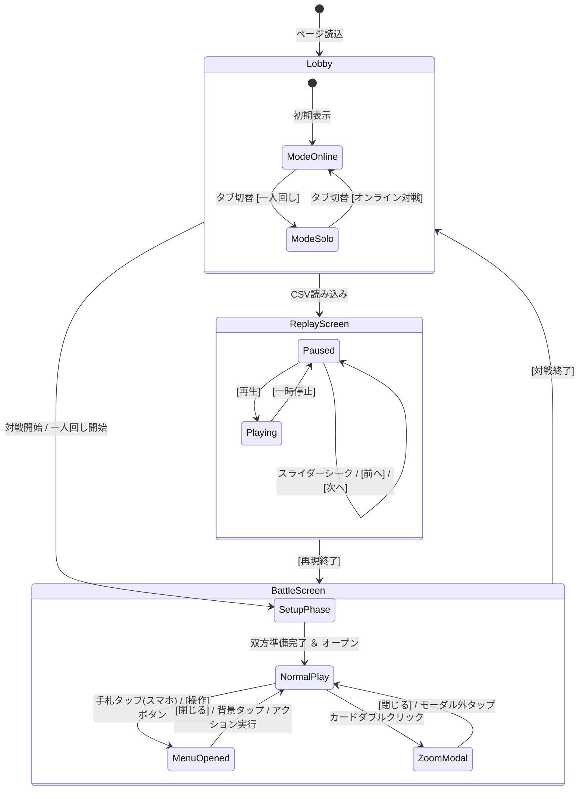
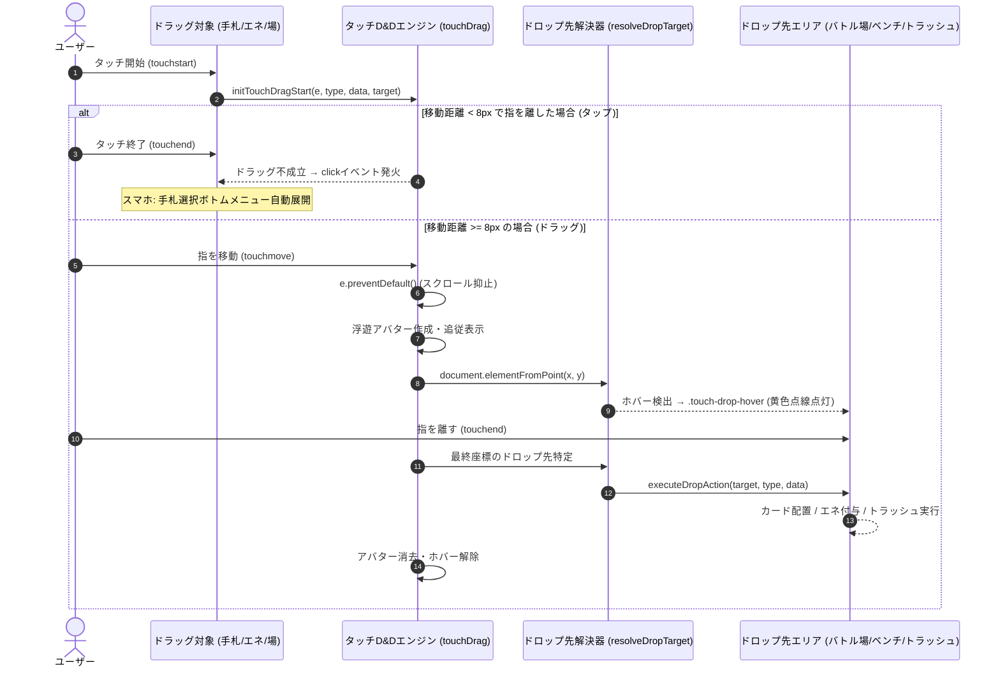
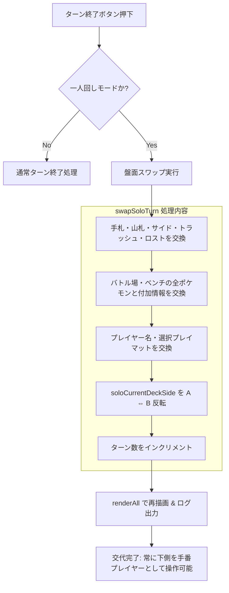
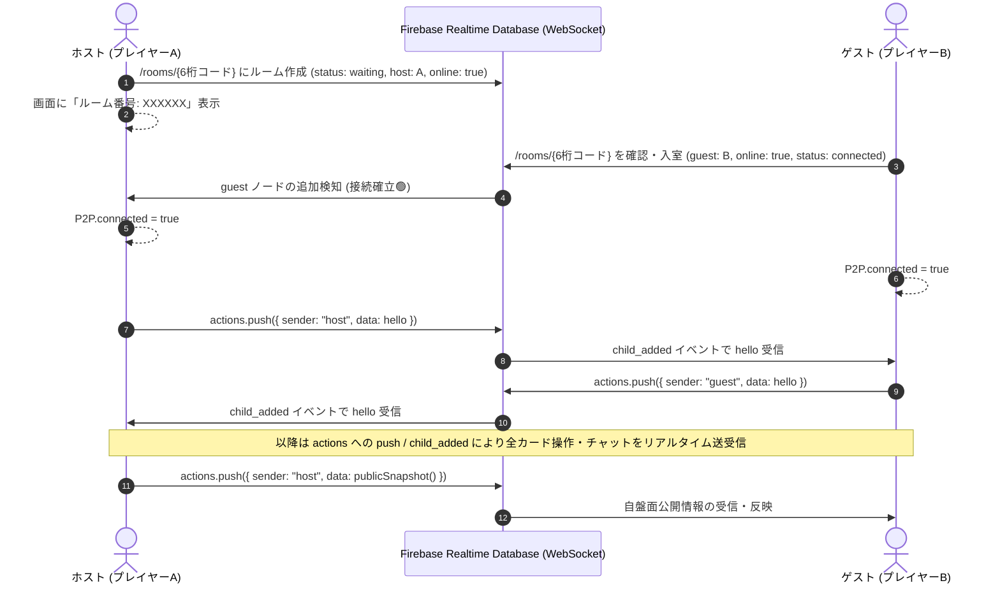
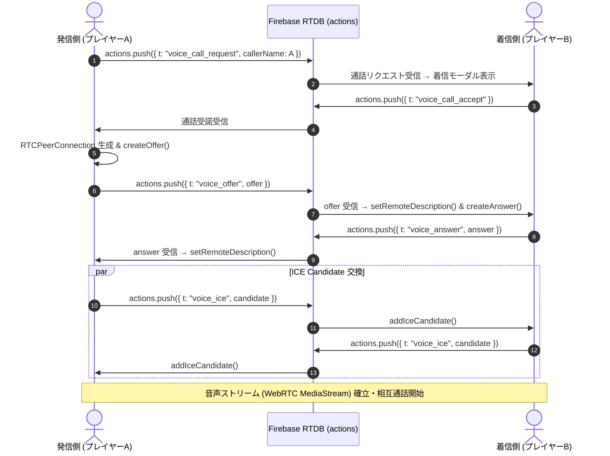

# ポケモンカード オンライン対戦ツール 詳細設計書

本書は、Webブラウザ上で動作するポケモンカードゲーム（ポケカ）のオンラインシミュレーターに関する詳細設計書（システムアーキテクチャ、データモデル、モジュール構成、UI/UX制御ロジック、通信仕様）です。

---

## 1. システム概要

### 1.1 システムの目的
本システムは、実際の紙のカードゲームと同様の自由度を持ち、複雑なルール自動判定を排してプレイヤーが直感的にカードを操作できる**手動操作型Web対戦シミュレーター**です。
P2P通信によるオンライン2人対戦に加え、1台の端末で2デッキを切り替えながら練習・研究できる「一人回し機能」、試合の全ステップを完全再現できる「CSV棋譜出力/リプレイ機能」、好みのプレイマットで対戦できる「背景プレイマット選択/自作登録機能」、およびスマホ画面でも快適に扱える「タッチドラッグ＆ドロップ」「手札選択時ボトムシート」を備えます。

### 1.2 システム構成方針
1. **完全クライアント完結型（サーバーレス）**:
   - HTML5, CSS3, Vanilla JavaScript (ES6+) のみで構築。
   - バックエンドサーバープロセスの保守・運用を排し、静的ホスティング（GitHub Pages, S3, 各種Webサーバー）で即時稼働。
2. **クラウドリアルタイム同期（Firebase Realtime Database）**:
   - ルーム管理、盤面同期、対戦ログ、チャット、およびボイスチャット用シグナリングを Firebase Realtime Database（WebSocket / HTTPSポート443）経由で実行。
   - Symmetric NAT、キャリアグレードNAT(CGNAT)、企業・大学Wi-Fiなど従来のP2P直接通信で失敗しやすかった環境でも100%接続成功を実現。
3. **ローカル永続化（localStorage）**:
   - 自作プレイマット画像などのユーザー個別データはブラウザの `localStorage` に保存。

---

## 2. システムアーキテクチャ設計

### 2.1 全体構造図

```mermaid
graph TD
    subgraph Client [ブラウザ クライアント]
        UI[UI View Layer (HTML/CSS)]
        State[State Manager (state オブジェクト)]
        
        subgraph Subsystems [サブシステム]
            TouchDnD[タッチD&Dエンジン (touchDrag)]
            Marquee[矩形範囲選択エンジン (marqueeState)]
            SoloEngine[一人回しエンジン (swapSoloTurn)]
            ReplayEngine[CSV棋譜・試合再現エンジン (Replay)]
            MatManager[プレイマット管理 (localStorage)]
            NetworkManager[通信マネージャー (Firebase RTDB)]
            VoiceEngine[ボイス通話エンジン (WebRTC Native)]
        end
        
        UI --> State
        TouchDnD --> State
        Marquee --> State
        SoloEngine --> State
        ReplayEngine --> State
        MatManager --> State
        NetworkManager --> State
        VoiceEngine --> State
        State --> UI
    end

    FirebaseRTDB[(Firebase Realtime Database)]
    OpponentClient[対戦相手ブラウザ]

    NetworkManager <===>|WebSocket (actions / state)| FirebaseRTDB
    FirebaseRTDB <===>|WebSocket (actions / state)| OpponentClient
    VoiceEngine <-->|シグナリング (Offer/Answer/ICE)| FirebaseRTDB
    VoiceEngine <===>|WebRTC Native Audio (P2P)| OpponentClient
```

### 2.2 ディレクトリ構成とモジュール責務

本プロジェクトは、単一ファイル構成のプロトタイプ（`demo/`）から、機能別モジュール構成（`src/`）へ移行しています。ブラウザでローカルファイル（`file://`）を直接開いた場合でも CORS エラーが発生せず即座に動作するよう、ES Modules (`import`/`export`) ではなく**順序付けされた `<script>` タグによるグローバル連携**を採用しています。

#### 1. モジュール構成 (`src/`)

```
src/
├── index.html                  # エントリーポイント（PeerJS CDN + 各種スクリプト読込）
├── README.md                   # src 実行ガイド & モジュール一覧
├── css/
│   └── style.css               # スタイル定義（盤面レイアウト、すりガラス調UI、レスポンシブ）
└── js/
    ├── data/
    │   ├── cards.js            # サンプルデッキ(リザードンex/フシギバナex)、カード定義、エネルギー色定義
    │   ├── deck-parser.js      # デッキコード解析・公式コード取得・テキスト貼付読込・プリセット管理
    │   └── playmats-default.js # プリセットプレイマット10種（グラデーション定義）
    ├── game/
    │   ├── setup.js            # 対戦・一人回しセットアップ（手札・サイド・バトル場初期化）
    │   ├── hand-actions.js     # 手札・場のカード操作（プレイ、エネ装着、進化、トラッシュ、ロスト、山札戻し）
    │   ├── actions.js          # 山札ドロー、使用カード、ダメカン変更、ターン進行、一人回しスワップ(swapSoloTurn)
    │   └── replay.js           # CSV棋譜エクスポート/インポート、完全試合再現・再生コントローラー
    ├── ui/
    │   ├── render.js           # 盤面・手札・エネルギー・スマホ用ボトムシートの動的DOMレンダリング
    │   ├── marquee.js          # 手札の矩形範囲選択（マウスドラッグによる複数選択）
    │   ├── touch-dnd.js        # タッチ操作ドラッグ＆ドロップエンジン（アバター追従・ドロップ先解決）
    │   ├── modals.js           # 山札確認・トラッシュ確認・サイド確認モーダル、ログ、トースト通知
    │   ├── lobby.js            # ロビー画面制御（通常対戦/一人回しタブ切替、デッキプレビュー、貼付モーダル）
    │   └── playmat.js          # プレイマット選択UI、自作マット画像登録/削除（localStorage連携）
    ├── net/
    │   └── p2p.js              # PeerJS(WebRTC)によるP2P直接通信、状態同期、情報隠蔽、スタジアム同期
    ├── util.js                 # 共通ユーティリティ（Fisher-Yatesシャッフル、UID生成等）
    ├── state.js                # アプリケーション全体の共有状態 `state` オブジェクト定義
    └── main.js                 # 初期化、HTMLからの `actions.*` 委譲ハンドラー定義、イベントリスナー登録
```

#### 2. スクリプト読み込み順序と依存関係

| 読込順 | モジュールパス | 主な公開シンボル・責務 | 依存モジュール |
| :---: | :--- | :--- | :--- |
| 1 | `peerjs.min.js` (CDN) | `window.Peer` | なし（外部CDNライブラリ） |
| 2 | `js/data/cards.js` | `SAMPLE_DECK`, `SAMPLE_DECK_B`, `ENERGY_CONFIG` | なし |
| 3 | `js/data/deck-parser.js` | `PRESET_DECKS`, `resolveDeckInput()`, `parseDeckListText()` | cards.js |
| 4 | `js/util.js` | `shuffleArray()` 等 | なし |
| 5 | `js/data/playmats-default.js` | `DEFAULT_PLAYMATS` | なし |
| 6 | `js/state.js` | `state` (グローバル状態オブジェクト) | cards.js, util.js |
| 7 | `js/game/setup.js` | `startBattleSetup()`, `startSoloBattleSetup()` | state.js, cards.js, util.js |
| 8 | `js/ui/render.js` | `renderAll()`, `updateSheetUI()` | state.js, p2p.js (`syncSoon`) |
| 9 | `js/ui/marquee.js` | `initMarqueeSelection()` | state.js, render.js |
| 10 | `js/ui/touch-dnd.js` | `initTouchDragStart()`, `resolveDropTarget()` | state.js, render.js, hand-actions.js |
| 11 | `js/game/hand-actions.js` | 手札配置・エネ装着・どうぐ装備ロジック | state.js, render.js |
| 12 | `js/game/actions.js` | `endTurn()`, `swapSoloTurn()`, `modifyDamage()` | state.js, render.js |
| 13 | `js/ui/modals.js` | `showDeckModal()`, `showToast()`, `addLog()` | state.js, render.js |
| 14 | `js/game/replay.js` | `exportMatchCsv()`, `loadMatchCsv()`, `applyReplayStep()` | state.js, render.js |
| 15 | `js/ui/lobby.js` | `initLobby()`, `renderDeckPreview()`, `openDeckPasteModal()` | state.js, setup.js, deck-parser.js |
| 16 | `js/ui/playmat.js` | `initPlaymats()`, `selectPlaymat()`, `handleCustomPlaymatUpload()` | state.js, playmats-default.js |
| 17 | `js/net/p2p.js` | `P2P` (P2P通信マネージャー) | state.js, render.js |
| 18 | `js/main.js` | アプリケーション初期化, `actions` グローバルエクスポート | 全モジュール |

#### 3. 旧構成・ドキュメント

| ファイルパス | 責務・備考 |
| :--- | :--- |
| `demo/index.html` | プロトタイプ用シングルページ（参照用として維持） |
| `demo/css/style.css` | プロトタイプ用スタイルシート |
| `demo/js/app.js` | プロトタイプ用統合スクリプト |
| `doc/specifications.md` | 機能仕様書・画面仕様書（キャプチャ画像付き） |
| `doc/design.md` | 本書（アーキテクチャ・データ構造・P2P通信仕様・詳細設計） |

---

## 3. データモデル & 状態管理設計

### 3.1 グローバル状態オブジェクト (`state`)
アプリケーションの全ライフサイクルは `src/js/state.js` で定義された単一の `state` オブジェクトで一元管理されます。

```typescript
interface AppState {
  // プレイヤー基本情報
  myName: string;                // 自プレイヤー名（初期値: "プレイヤーA"）
  oppName: string;               // 相手プレイヤー名（初期値: "プレイヤーB（BOT）"）
  roomNo: string;                // ルーム番号（6桁数字、または "SOLO-PRACTICE"）
  turn: number;                  // 現在のターン数（1〜）
  turnStep: number;              // ターン進行ステップ（1: 先攻1ターン目, 2: 後攻1ターン目, 3: 先攻2ターン目...）

  // 対戦準備フェーズ状態
  isSetupPhase: boolean;         // 対戦準備中フラグ
  setupStep: "coin" | "order" | "place" | "ready" | "done"; // 準備フェーズ詳細ステップ
  coinResult: "heads" | "tails" | null; // コイントス結果（表/裏）
  coinChooser: "host" | "guest" | null; // 先攻/後攻の選択権保持者
  firstPlayer: "host" | "guest" | null; // 先攻決定者
  mySetupReady: boolean;         // 自分の対戦準備完了フラグ
  oppSetupReady: boolean;        // 相手の対戦準備完了フラグ
  mulliganCount: number;         // 自分のマリガン実行回数
  oppMulliganCount: number;      // 相手のマリガン実行回数
  myMulliganStep: string | null; // 自マリガン状態同期
  oppMulliganDeclared: boolean;  // 相手マリガン宣言フラグ
  pendingOppMulliganQueue: Card[][]; // 相手マリガン手札確認キュー

  // 自分側カードゾーン
  myDeck: Card[];                // 山札（カード配列、先頭が山の上）
  myHand: Card[];                // 手札（カード配列）
  myActive: FieldPokemon | null; // バトル場ポケモン
  myBench: (FieldPokemon | null)[]; // ベンチポケモン（最大8枠、通常5枠）
  myBenchLimit: number;          // ベンチ枠数上限（5 または 8）
  myPrizes: Card[];              // サイド（未取得のカード配列）
  myTrash: Card[];               // トラッシュ（カード配列）
  myLost: Card[];                // ロストゾーン（カード配列）

  // テンポラリエリア ＆ 使用カード
  tempCards: Card[];             // テンポラリエリアのカード配列
  playCard: Card | null;         // 現在使用中カード（使用カードエリア）
  oppPlayCard: Card | null;      // 相手が使用カードエリアに置いているカード
  historyStack: any[];           // 直近の盤面スナップショット履歴（1手順巻き戻し用、最大15手順）

  // 共有ゾーン
  stadium: Card | null;          // 場に出ているスタジアムカード
  stadiumTs: number;             // スタジアム最終変更UNIXミリ秒（P2P同期時のLast-Write-Wins競合解決用）

  // 相手側カードゾーン (P2P受信時 または 一人回し時に更新)
  oppDeckCount: number;          // 相手山札残数
  oppHandCount: number;          // 相手手札枚数
  oppPrizes: number;             // 相手サイド残数（0〜6）
  oppTrash: Card[];              // 相手トラッシュ
  oppLostCount: number;          // 相手ロストゾーン枚数
  oppActive: FieldPokemon | null;// 相手バトル場ポケモン
  oppBench: (FieldPokemon | null)[]; // 相手ベンチポケモン（最大8枠）
  oppBenchLimit: number;         // 相手ベンチ枠数上限（5 または 8）
  oppExited: boolean;            // 相手退室検知フラグ

  // UI選択・ドラッグ状態
  selectedHandIndices: Set<number>; // 複数選択された手札インデックス群
  selectedHandIndex: number;     // getter/setter（単一選択アクセスとの後方互換）
  draggedHandIndex: number;      // 現在ドラッグ中の手札インデックス（-1: なし）
  draggedEnergy: { location: string; energyIndex: number } | null; // ドラッグ中エネルギー情報
  actionTargetMode: string | null;// アクション選択待ちモード ("active" | "bench")

  // プレイマット
  myMatId: string;               // 自分のプレイマットID（"mat_01"〜"mat_10" または "custom_..."）
  oppMatId: string;              // 相手のプレイマットID
  oppMatDataUrl: string | null;  // 相手の自作マット画像DataURL

  // 一人回し（ソロプレイ）状態
  isSoloMode: boolean;           // 一人回し中フラグ
  oppDeck: Card[];               // 一人回し用の完全な相手山札
  oppHand: Card[];               // 一人回し用の完全な相手手札
  oppPrizesList: Card[];         // 一人回し用の完全な相手サイド
  oppLost: Card[];               // 一人回し用の完全な相手ロスト
  soloDeckA: Card[];             // デッキAの登録カード配列（先攻）
  soloDeckB: Card[];             // デッキBの登録カード配列（後攻）

  // 試合ログ
  logs: string[];                // 画面ログ文字列配列（タイムスタンプ付き）
}
```

### 3.2 カードおよび場のポケモンデータ構造

#### 1. カードオブジェクト (`Card`)
```typescript
interface Card {
  uid: string;                   // ユニークID（例: "c_12", "init_hitokage", "opp:c_12"）
  name: string;                  // カード名（例: "リザードンex"）
  type: "pokemon" | "trainer" | "energy"; // 大種別
  category?: string;             // 種別詳細（"たね", "1進化", "2進化", "グッズ", "サポート", "スタジアム"）
  sub?: string;                  // サブ種別（"ポケモンのどうぐ", "特殊エネルギー" 等）
  color: string;                 // UIカラー分類（"fire", "water", "grass", "trainer", "energy" 等）
  hp?: number;                   // ポケモンの最大HP
  imageUrl?: string;             // カード画像URL（任意）
}
```

#### 2. 特殊状態オブジェクト (`PokemonConditions`)
```typescript
interface PokemonConditions {
  poison: boolean;               // どく（毎ポケモンチェック +10）
  burn: boolean;                 // やけど（毎ポケモンチェック +20）
  special: "paralyzed" | "confused" | "asleep" | null; // まひ/こんらん/ねむり（排他）
}
```

#### 3. 場のポケモンオブジェクト (`FieldPokemon`)
```typescript
interface FieldPokemon {
  card: Card;                    // ポケモン本体カード（進化後は最新カード）
  damage: number;                // 蓄積ダメカン（ダメージ値: 10刻み、100刻み増減対応）
  energies: Card[];              // ついているエネルギーカード配列
  tool: Card | null;             // 装備しているポケモンのどうぐカード
  conditions: PokemonConditions; // 特殊状態（どく・やけど・まひ・こんらん・ねむり）
  abilityUsed: boolean;          // このターンの特性使用済みフラグ（ターン終了時リセット）
}
```

### 3.3 プレイマットデータモデル

プリセット（`DEFAULT_PLAYMATS` 10種）と、ユーザーがブラウザ上で画像をアップロードした自作マット（`localStorage`）を統合して扱います。

```typescript
// プリセットプレイマット
interface PresetPlaymat {
  id: string;                    // "mat_01" 〜 "mat_10"
  name: string;                  // 表示名（"クラシック・ネイビー", "クリムゾン・レッド" 等）
  type: "gradient";              // 種別
  bg: string;                    // CSS radial-gradient 定義式
  accent: string;                // アクセントカラーHEX（#3b82f6 等）
}

// ユーザー自作プレイマット
interface CustomPlaymat {
  id: string;                    // "custom_" + Date.now() (一意のタイムスタンプID)
  name: string;                  // ユーザー入力のマット名
  isCustom: true;                // 自作登録フラグ
  dataUrl: string;               // Base64 DataURL (画像ファイルデータ)
}

type Playmat = PresetPlaymat | CustomPlaymat;
```
- **保存キー**: `localStorage.getItem("pokeca_custom_playmats_v1")`
- **保存形式**: JSON文字列化された `CustomPlaymat[]` 配列。
- **削除機能**: UI上で `×` ボタンを押すことで `deleteCustomPlaymat(matId)` により個別削除可能。

---

## 4. UI ＆ 画面レイアウト設計

### 4.1 画面状態遷移



### 4.2 プレイマット2分割レンダリング仕様
対戦画面背景（`#game .board-mat-container`）は、2枚の長方形画像を画面上下に配置します。

```
+-------------------------------------------------------+
|  【画面上半分】                                        |
|  相手プレイヤーのプレイマット (ID: oppMatId)            |
|  CSS: transform: rotate(180deg); （対面向きに反転表示） |
+-------------------------------------------------------+
|  【画面下半分】                                        |
|  自分プレイヤーのプレイマット (ID: myMatId)             |
|  CSS: 手前向き通常表示                                  |
+-------------------------------------------------------+
```

---

## 5. インタラクション ＆ イベント処理設計

### 5.1 ハイブリッド ドラッグ＆ドロップ アーキテクチャ

PCの**HTML5 Drag & Drop API**と、スマホ・タブレットの**Touch Events API**を透過的に処理する統合ドラッグエンジンを実装しています。



### 5.2 ドロップ解決ロジック (`resolveDropTarget`)

| ドラッグ種別 (`type`) | 検出ドロップ先 | 判定条件 (`hitEl.closest(...)`) | 実行処理 (`executeDropAction`) |
| :--- | :--- | :--- | :--- |
| **手札カード** (`hand`) | 使用カードエリア | `#play-area` | `playHandCardByIndex(handIdx)` |
| | 空きバトル場 | `#my-active` (ポケモンなし) | `placeHandCardToActive(handIdx)` |
| | バトル場ポケモン | `#my-active` (ポケモンあり) | `attachHandCardToPokemon(handIdx, "active")` |
| | 空きベンチ枠 | `#my-bench [data-bench-index]` (空き) | `placeHandCardToBenchIndex(handIdx, bIdx)` |
| | ベンチポケモン | `#my-bench [data-bench-index]` (あり) | `attachHandCardToPokemon(handIdx, "bench_" + bIdx)` |
| | スタジアム | `#stadium` | `placeHandCardToStadium(handIdx)` |
| | トラッシュ | `#my-trash` | `trashHandCardByIndex(handIdx)` |
| | ロストゾーン | `#my-lost` | `lostHandCardByIndex(handIdx)` |
| | 山札 | `#my-deck` | `moveHandCardToDeckBottom(handIdx)` |
| **エネルギーバッジ** (`energy`) | 別のポケモン | `#my-active` または `#my-bench [data-bench-index]` | `moveEnergyBetweenPokemon(srcLoc, energyIdx, dstLoc)` |
| | トラッシュ | `#my-trash` | `detachEnergyToTrash(srcLoc, energyIdx)` |
| **使用中カード** (`playCard`) | トラッシュ / 手札 / スタジアム / ロスト | `#my-trash`, `#hand`, `#stadium`, `#my-lost` | 各移動関数を実行 |

### 5.3 スマホ専用 手札選択ボトムメニュー (`sp-sheet`)

#### 動作シーケンス
1. スマホ環境判定:
   ```javascript
   function isMobileMode() {
     return window.innerWidth <= 768 || 
            window.matchMedia("(orientation: portrait)").matches ||
            ('ontouchstart' in window && window.innerWidth <= 1024);
   }
   ```
2. 手札カードタップ時:
   `isMobileMode() === true` の場合、即座に `selectHandCardAndOpenMenu(idx)` をコール。
3. `updateSheetUI()` による動的UI生成:
   - **単一カード選択時**:
     - カード名称・種別バッジ・HPのプレビューカードを表示。
     - カード種別に応じた専用ボタン（使用、バトル場、ベンチ、エネ付与対象ボタン一覧、どうぐ装備対象ボタン一覧、スタジアム、トラッシュ、ロスト、山札上/下、拡大）。
   - **複数カード選択時**:
     - `選択中: N枚` バナーを表示。
     - まとめトラッシュ、まとめロスト、まとめ山札上/下、選択ポケモンをベンチへの一括操作ボタンを表示。
   - **未選択時**:
     - ガイドテキストおよび山札ドロー、山札確認ボタンを表示。

---

## 6. 一人回しエンジン設計 (Solo Practice Engine)

### 6.1 デュアルデッキ初期化ロジック
ロビーで登録された2つのデッキ（デッキA: 先攻、デッキB: 後攻）から、双方60枚の独立したカードインスタンスを生成して初期化します。

```javascript
function startSoloBattleSetup() {
  state.isSoloMode = true;
  state.soloCurrentDeckSide = "A"; // デッキA（先攻）から開始
  // 先攻（デッキA）セットアップ
  state.myDeck = shuffleArray([...soloDeckA]);
  state.myHand = state.myDeck.splice(0, 7);
  state.myPrizes = state.myDeck.splice(0, 6);
  // 後攻（デッキB）セットアップ
  state.oppDeck = shuffleArray([...soloDeckB]);
  state.oppHand = state.oppDeck.splice(0, 7);
  state.oppPrizesList = state.oppDeck.splice(0, 6);
  state.oppPrizesCount = 6;
  ...
}
```

### 6.2 ターン終了時 上下自動ローテーション (`swapSoloTurn`)
ターン終了ボタン（`[ターン終了]`）が押下された際、現在の自分側の盤面と相手側の盤面を完全にスワップします。



---

## 7. CSV棋譜出力 ＆ 完全試合再現設計

### 7.1 CSVデータ仕様
対戦中のあらゆる操作（ドロー、カード使用、エネ装着、ダメカン変更、ターン交代等）が発生するたびに、完全な盤面スナップショットをJSON化してBase64エンコードし、CSVの1行として記録します（`src/js/game/replay.js`）。
出力時は `\uFEFF`（UTF-8 BOM）を付与し、Microsoft Excelや各種スプレッドシートソフトで文字化けなく直接開ける設計です。

#### CSVフォーマット定義（全11カラム）
```csv
Step,Turn,Timestamp,Player,Action,CardName,FromZone,ToZone,Details,LogMessage,Snapshot
```

| カラム名 | 型 | 説明 | 例 |
| :--- | :--- | :--- | :--- |
| `Step` | 整数 | 1から始まる連番の手数 | `1`, `2`, `3` |
| `Turn` | 整数 | 現在のターン数 | `1` |
| `Timestamp` | 文字列 | ISO 8601 形式のタイムスタンプ | `2026-10-09T15:30:00.000Z` |
| `Player` | 文字列 | 行動したプレイヤー名 | `プレイヤーA` |
| `Action` | 文字列 | 行動種別識別子 | `MATCH_START`, `DRAW`, `PLAY`, `ATTACH_ENERGY`, `END_TURN`, `SOLO_SWAP` |
| `CardName` | 文字列 | 対象カード名（空文字可） | `リザードンex` |
| `FromZone` | 文字列 | 移動元ゾーン識別子 | `hand`, `deck`, `active`, `bench`, `playArea` |
| `ToZone` | 文字列 | 移動先ゾーン識別子 | `active`, `bench`, `trash`, `lost`, `hand` |
| `Details` | 文字列 | 補足詳細情報 | `手札からバトル場へ配置` |
| `LogMessage` | 文字列 | 画面ログに表示された日本語メッセージ | `「リザードンex」をバトル場に出しました` |
| `Snapshot` | 文字列 | 盤面全状態のJSONをBase64化した文字列 | `eyJteUhhbmQiOls...` |

### 7.2 リプレイ復元ロジック
CSVファイルをインポートすると、全行のレコードがパースされて `matchHistory` 配列に格納され、リプレイバー（再生・一時停止・ステップシーク）により任意のステップの状態を復元・同期描画します。

```javascript
function applyReplayStep(stepIndex) {
  const record = matchHistory[stepIndex];
  if (!record || !record.snapshot) return;
  restoreSnapshot(record.snapshot); // 手札・場・エネ・ダメカン・プレイマット全状態を復元
  renderAll();                      // 盤面を同期描画
  updateReplayUI(stepIndex);        // シークバー・現在ステップ数表示を更新
}
```

---

## 8. オンライン通信・ネットワークアーキテクチャ設計 (Firebase Realtime Database & WebRTC)

`src/js/net/p2p.js` および `src/js/net/voice.js` では、**Firebase Realtime Database** を中核とした堅牢なリアルタイム通信アーキテクチャを採用しています。

### 8.1 接続確立フロー (Firebase Realtime Database)

従来のSTUNサーバーのみに依存したP2P直接通信（WebRTC DataChannel）では、Symmetric NAT、モバイル回線のCGNAT、学校・オフィスのファイアウォール環境下でNAT越えが失敗（接続成功率70〜80%程度）する課題がありました。
本システムでは、WebSocket / HTTPS（標準ポート443）経由で通信する Firebase Realtime Database を採用し、**あらゆるネットワーク環境で100%確実に接続・盤面同期**できる構成としています。



### 8.2 ボイスチャット通信フロー (WebRTC Native + Firebase Signaling)

音声データストリーム自体はブラウザ標準の `RTCPeerConnection` による超低遅延 P2P 通信を行い、その接続確立に必要なシグナリング（Offer, Answer, ICE Candidate）を Firebase Realtime Database 経由で送受信します。



#### 通話中UI設計（対戦盤面優先＆レスポンシブ）
1. **PC／デスクトップ環境**:
   - 通話バー（`.voice-call-bar`）を画面左上（`left: 16px; top: 68px;`）に配置し、中央上部の相手ベンチカード（`#opp-bench`）の視認やクリック操作への被りを完全解消。
   - `_makeBarDraggable()` によるポインタードラッグに対応し、プレイヤーが任意の位置へ移動可能。
   - 上部メニューの通話ボタンにも `🎙️ 通話中 (00:00) <span class="voice-live-dot"></span>` が表示され、クリックで通話管理モーダルを開くことも可能。
2. **スマートフォン環境（画面幅 768px 以下）**:
   - 画面が狭くベンチや手札のタッチ操作を最優先するため、画面上の通話バーは非表示（`display: none !important;`）。
   - ドロワーメニュー内の「🎙️ 通話」ボタンに通話中ハイライトと鼓動アニメーションの「🔴 赤い丸」（`.voice-live-dot`）を表示。
   - 通話中ボタンをタップすることで「通話管理モーダル」が起動し、ワンタップでマイクミュート切替や通話終了が可能。

### 8.3 メッセージプロトコル仕様

Firebase の `/rooms/{6桁コード}/actions` を通じて送信されるJSONメッセージは `t` プロパティ（Type）で識別されます。

#### 1. 接続挨拶メッセージ (`t: "hello"`)
接続確立直後に送信し、互いの表示名と選択プレイマットを同期します。
```json
{
  "t": "hello",
  "name": "プレイヤーA",
  "matId": "mat_01"
}
```

#### 2. 公開盤面同期スナップショット (`t: "state"`)
盤面変化時（`renderAll()` 呼び出し時）に `syncSoon()`（60msデバウンス）を介して送信されます。
```json
{
  "t": "state",
  "name": "プレイヤーA",
  "matId": "mat_01",
  "handCount": 5,
  "deckCount": 42,
  "prizes": 6,
  "trash": [ { "name": "博士の研究", "uid": "c_1", "type": "trainer", "color": "trainer" } ],
  "lostCount": 0,
  "active": { "card": { "name": "リザードンex" }, "damage": 20, "energies": [...], "tool": null },
  "bench": [ { ... }, null, null, null, null ],
  "stadium": { "name": "ボウルタウン", "uid": "c_stadium_1" },
  "stadiumTs": 1728456789123,
  "turn": 3
}
```

### 8.4 情報隠蔽・不正防止モデル
対戦相手の不正覗き見を防止するため、**手札カード・山札カード・サイドカードの中身は相手に送信しません**。
- 送信されるのは `handCount`（手札枚数）、`deckCount`（山札枚数）、`prizes`（サイド枚数）のみです。
- 受信側は裏面画像または数字バッジとしてのみ相手の手札・山札・サイドを表示します。
- バトル場・ベンチ・トラッシュ・スタジアムなど「場に公開されたカード情報」のみ実データが共有されます。

### 8.5 スタジアム共有ゾーンの競合解決 (Last Write Wins)
スタジアムは両プレイヤー共通の1枠しかない共有ゾーンです。
- スタジアムが場に出された時、変更元のクライアントが `stadiumTs = Date.now()`（ミリ秒タイムスタンプ）を記録します。
- スナップショット受信時、`received.stadiumTs > local.stadiumTs` の場合のみ相手のスタジアムで上書きします。これにより通信遅延による古いスタジアム情報での意図しない上書きを防止します。

### 8.6 相手カードUIDの衝突防止 (`opp:` プレフィックス)
相手から受信したカードデータ（バトル場、ベンチ、トラッシュ、スタジアム）は、ローカルのカードUIDと衝突しないよう、UIDの先頭に `opp:` プレフィックスを自動付与して格納します（例: `opp:c_12`）。

---

## 9. 状態異常・ベンチ拡張・演出設計 (v7.0)

### 9.1 特殊状態（状態異常）管理とエフェクト
1. **状態異常の種別と競合ルール**:
   - `どく` (Poison): 毎ポケモンチェックに+10ダメージ。紫色のアニメーション気泡エフェクト（`.condition-poison-bubbles`）。
   - `やけど` (Burn): 毎ポケモンチェックに+20ダメージ。オレンジ・赤の燃焼炎パーティクルエフェクト（`.condition-burn-flames`）。
   - `まひ` / `こんらん` / `ねむり`: 3状態は公式ルールに基づき**排他制御**（いずれか1つのみ）。
     - まひ: 黄色の稲妻・スパークエフェクト（`.condition-paralyzed-sparks`）。
     - こんらん: 頭上のぐるぐる星・混乱エフェクト（`.condition-confused-stars`）。
     - ねむり: 浮遊する「Zzz」スリープエフェクト（`.condition-asleep-zzz`）。
   - どく・やけどは同時に重複して付加可能。
2. **自動解除トリガー**:
   - ベンチへの後退・入れ替え時（`swapBenchActive` 等）。
   - ポケモン進化時（`evolveActiveWithSelectedHand`, `evolveBenchWithSelectedHand`）。
3. **コンテキストメニューUI**:
   - ポケモンカードクリック時のメニューを2列化。
   - 「特殊状態」および「ダメカン操作」はサブメニューモーダルへ整理。
   - かかっている特殊状態のボタンは「○○を治す」トグル表記に動的変更。

### 9.2 ベンチ枠数拡張 (5枠 ⇔ 8枠)
- 通常上限は5枠。特性（テラスタルオーブ等）やスタジアム（ゼロの大空洞等）に応じて「ベンチ枠を8にする」ボタンを表示。
- 8枠モード時は「ベンチ枠を5にする」ボタンを表示。
- 5枠へ戻す際、ベンチに6匹以上のポケモンが存在する場合は「ポケモントラッシュ選択モーダル」を自動展開し、超過分をトラッシュするまで確定させない安全設計。

### 9.3 ターン表示・演出強化
- プレイヤー名の左側にターン中を示す「赤丸インジケーター」を表示。
- プレイヤー名の右側に「先攻」「後攻」バッジを明示。
- ターン表記は「先攻Xターン目」「後攻Xターン目」の正式表記。
- ターン開始・ターン交代時に「○○のターン（ターン数）」が右から流れて中央で静止、左へ流れるスライドバナー演出（2秒）。
- ターン最初の強制トップドロー機能と、ドローカードの大画面スポットライト演出。
- 相手ポケモンに対する操作メニュー（ダメカン・特殊状態・バトル場への呼び出し＝ボスの指令等）を実装。
- 勝敗決定時の勝利エフェクト（紙吹雪パーティクル・クラッカー放射・ゴールドトロフィー）のド派手演出。

### 9.4 UI/UX操作統一・連打・テンポラリ選択・シャッフル演出 (v9.0)

1. **ダメカン連打対応設計**:
   - `modifyDamage(location, index, delta, keepMenu = false)` / `modifyOpponentDamage(location, index, delta, keepMenu = false)` を拡張。
   - ダメカン操作サブメニューのボタン押下時は `keepMenu = true` とし、`#ctx` を閉じずに保持。
   - `renderAll()` により盤面のHP/ダメカン表示を更新すると同時に、メニュー上部の「現在: ○○」表示をリアルタイム更新。
   - サブメニューヘッダーの「✖」ボタンおよび下部の「✖ 完了（閉じる）」ボタンにより明示的に閉じられる設計。

2. **手札右クリックメニューの対象名ホバー展開**:
   - 「ポケモンにつける対象」「重ねて進化させる対象」ボタンに `data-fullname` 属性および `title` 属性を付与。
   - CSS擬似要素 `.ctx-sub-target[data-fullname]:hover::after` により、マウスオーバー時に完全なカード名・HP情報（例: `ベンチ1: かがやくゲッコウガ (HP130)`）が浮き出るカスタムツールチップを表示。
   - ボタン自体のテキストもホバー時に展開し、狭小カラムによる省略表示（`...`）を解消。

3. **テンポラリエリア個別選択 ＆ 移動制御**:
   - `state.selectedTempIndices`（`Set`）を導入。テンポラリカードをクリックすることで選択/選択解除（`.selected`によるゴールド枠 ＆ `✔ 選択中`バッジ）。
   - `extractTempCards()` 関数により、選択カードがある場合は選択分のみを抽出、未選択時は全カードを一括抽出。
   - `moveTempToHand`, `moveTempToTop`, `moveTempToBottom`, `moveTempToTrash` が選択抽出に対応。
   - 各アクションボタンの表示テキストを選択状態に応じて「手札に加える (選択N枚)」/「手札に加える (すべて)」と動的連動。

4. **全フィールドの操作系統一（Click / DblClick / ContextMenu）**:
   - 手札、自分バトル場、自分ベンチ、相手バトル場、相手ベンチで共通の操作インターフェースを確立：
     - **左クリック（Click）**: カード選択（青色発光枠 `.field-selected` の付与/解除）。
     - **ダブルクリック（DblClick）**: カード詳細モーダル拡大（`openCardZoom`）。
     - **右クリック（ContextMenu）**: 操作メニュー（`showPokemonMenu` / `showOpponentPokemonMenu`）。
   - タッチデバイス・スマホ判定時はタップ操作でメニューを展開し、モバイル環境の操作性を担保。

5. **ド派手な山札シャッフル演出 (Grand 3D Shuffle)**:
   - `playDeckShuffleEffect(isOpponent)` を大改修。
   - 山札位置から複数枚のカードパックが空中へ舞い上がり、左右に分割（`pack-left`, `pack-right`）。
   - 3Dパースペクティブ（`perspective: 1200px`）のもと、左右の束が激しく交差・リッフル回転して混ざり合うアニメーション。
   - 合体時の黄金フラッシュバースト（`fx-shuffle-flash`）および立体ポップアップバッジ（`🔀 SHUFFLE!!`）を画面上に展開。WebRTC同期により対戦相手の画面でも同等の演出を再生。

### 9.5 バトル場不在時の出撃選出フェーズ・操作ロック・敗北判定設計 (v10.0)

1. **ターン開始時におけるバトル場検証フロー**:
   - `P2P` 経由のターン交代メッセージ（`msg.t === "turn_change"`）受信後、または一人回しモードでのターン終了（`endTurn`）後のターンバナー演出完了時、`checkTurnStartActiveCondition(onReady)` を呼び出し。
   - `state.myActive` が存在する場合は通常通り `executeTurnStartDraw()`（ターン開始トップドロー）を実行。

2. **出撃選出フェーズ（ベンチにポケモンが存在する場合）**:
   - `state.mustPromoteToActive = true` を設定。
   - `showPromoteActiveModal(benchIndices, onComplete)` により、背景クリックや外枠クリックで閉じないモーダル（`dismissible: false`、`dataset.noBackdropClose = "true"`）を表示。
   - ベンチにいる全ポケモンカード（画像、HP、ダメージ、エネルギー数、どうぐ）と「⚔️ バトル場に出す」ボタンを一覧表示。
   - **完全操作ロック機構**:
     - `document.addEventListener("click", ..., true)` および `contextmenu`（キャプチャリングフェーズ）により、モーダル外（ロビー退室ボタン等を除く）の全クリック・右クリックを完全ブロックし、警告トーストを表示。
     - ターン終了ボタンは `state.mustPromoteToActive` 時「出撃待ち」表記となり `disabled` 化。
     - 山札ドロー、手札コンテキストメニュー、場のポケモンメニュー、空バトル場へのドロップ・クリックも全てガード。
   - プレイヤーが「⚔️ バトル場に出す」を押下すると、`promoteBenchToActive(benchIndex)` が実行され、`swapActiveBench` でバトル場へ配置、P2P同期、モーダルクローズ、`mustPromoteToActive = false` 解除を行い、コールバック経由で `executeTurnStartDraw()`（ターン開始トップドロー）が安全に発火。

3. **敗北判定（バトル場不在かつベンチにもポケモンがいない場合）**:
   - `benchIndices.length === 0` を検知した場合、即座に `handleNoPokemonDefeat()` を実行。
   - 対戦ログに「場にポケモンがいなくなったため敗北」を記録。
   - P2P対戦モードでは相手へ `P2P.send({ t: "victory", winnerName: state.oppName, reason: "..." })` を送信。
   - 自画面では対戦決着/敗北オーバーレイ画面（`playGrandVictoryEffect`）を表示し、相手画面では完全な勝利エフェクト（トロフィー・紙吹雪）を自動再生。

### 9.6 マリガン差分ドロー・スマホ最適化・ホバー安定化・サイド操作統一設計 (v11.0)

1. **マリガンペナルティ（差分ドロー）設計**:
   - `state.mySetupReady` および `state.oppSetupReady` が完了した直後、`handlePreMatchMulliganPenalty()` を発火。
   - 差分計算: `diff = state.oppMulliganCount - state.mulliganCount`。
   - `diff > 0`（相手のマリガンが多い場合）: 自分に選択ダイアログ（`showMulliganPenaltyModal`）を表示。「はい、引きます」で山札から `diff` 枚ドローし、P2Pメッセージ `mulligan_penalty_done` を送信後に対戦開始。「引かない」選択時はドローなしで開始。
   - `diff < 0`（自分のマリガンが多い場合）: 相手の選択待ちモーダルを表示し、相手からの `mulligan_penalty_done` 受信をトリガーとして同期して対戦開始。
   - `diff === 0`（同数またはマリガンなし）: 追加処理を行わず、直ちに `finishSetupPhaseAndStartBattle()` を実行。

2. **カード表示最適化（イラスト全開表示）**:
   - 画像付きカード（`.card.has-img`）において、`.card-top .name` および `.card-btm` を `display: none` とし、暗い背景帯を撤廃。
   - イラスト全体を遮る文字オーバーレイを排除し、ダメージカウンター（`.dmg`）、エネルギーアイコン、状態異常エフェクト、どうぐタブのみをスマートに重ねる実物カード／PTCGL準拠のデザインを実現。

3. **スマホ版ベンチ配置のPTCGL準拠化**:
   - 従来の「3＋2の2段折り返し（`flex-wrap: wrap`）」を撤廃し、横1列のスマート配置（`flex-wrap: nowrap; overflow-x: auto;`）に変更。
   - スクロールバーは `scrollbar-width: none` で非表示化。
   - 「ベンチ枠を8にする」ボタンを専用ヘッダーバー（`.bench-ctrl-bar`）に配置し、カードへの重なりを解消。

4. **ホバー判定ループ振動の完全防止 (Hover Jitter Fix)**:
   - 手札カードホバー時に上方向（`translateY`）に持ち上がる際、カード下端からマウスが抜けてホバーのON/OFFが秒間60〜120回ループする不具合を解決。
   - `.hand-cards .card:hover::after` に透明な下方向ヒット領域を展開し、カードが上に持ち上がってもカーソルが要素内に留まり続ける構造を採用。
   - `.card` に `will-change: transform; transform: translateZ(0); backface-visibility: hidden;` を付与し、非全画面時やブラウザ拡大表示時のサブピクセル描画ブレを完全抑制。

5. **サイドカード操作の完全統一（右クリックコンテキストメニュー）**:
   - サイドの各カードに `oncontextmenu` イベントをバインド。
   - 右クリック時に「🖐️ 手札に加える」「👁️ 表を確認する（拡大表示）」「🔀 山に戻す（シャッフル）」「🗑️ トラッシュする」「🌀 ロストゾーンに送る」を選択可能なコンテキストメニュー（`showPrizeMenu`）を展開。
   - PCでの左クリックは直感的にサイド取得を実行、スマホ時はタップでコンテキストメニューを表示。

### 9.7 8枠ベンチ配置解除 ＆ スマホ版2段ベンチ設計 (v11.1)

1. **8枠ベンチ配置制限の動的制御**:
   - `placeHandCardToBenchIndex(handIdx, benchIdx)`:
     - 従来のハードコード `benchIdx >= 5` を `benchIdx >= (state.myBenchLimit || 5)` に改修。
   - `placeHandCardToFirstEmptyBench(handIdx)`:
     - `limit = state.myBenchLimit || 5` までのスロットを探索し、最大数に応じた警告メッセージを表示。
   - `placeSelectedHandToBench()`:
     - `state.myBench.forEach`（初期5スロット限定）を廃止し、`limit` までの空きスロットを走査して配置。
   - `touch-dnd.js`:
     - タッチD&Dでのドロップ先判定において、`bIdx < limit` の範囲を許容。
   - `setup.js`:
     - `state.myBench` および `state.oppBench` の初期化配列長を常に8スロット分（`[null, null, ...]`）確保。

2. **スマホ版PTCGL準拠2段グリッドレイアウト設計**:
   - モバイル縦画面メディアクエリ（`@media (orientation: portrait), (max-width: 768px)`）において、`.bench-tray` をCSS Grid化。
   - **5枠モード（前3・後2）**:
     - `grid-template-columns: repeat(6, 1fr)` を採用。
     - 自分ベンチ: 前列（バトル場側・上段 row 1）にスロット1（cols 1-2）、スロット2（cols 3-4）、スロット3（cols 5-6）。後列（手札側・下段 row 2）にスロット4（cols 2-3）、スロット5（cols 4-5）を中央寄せ配置。
     - 相手ベンチ: 前列（バトル場側・下段 row 2）にスロット1〜3、後列（相手側・上段 row 1）にスロット4〜5を中央寄せ配置。
   - **8枠モード（前4・後4）**:
     - `grid-template-columns: repeat(4, 1fr)` を採用。
     - 自分ベンチ: 前列（row 1）にスロット1〜4、後列（row 2）にスロット5〜8を配置。
     - 相手ベンチ: 前列（row 2）にスロット1〜4、後列（row 1）にスロット5〜8を配置。
   - 高さ変数 `--bench-h: min(7.6vh, 15vw)` により、22vhの帯域（band）内に収まる安全設計。

3. **非全画面・狭小画面でのホバー振動（Jitter）完全防止設計**:
   - **問題の本質**:
     - `.hand-cards` に `overflow: hidden` が設定されていたため、狭小画面（手札高さ15.5vh）においてカードが `translateY` で上部に移動した際、上端および下端のヒット領域（`::after`）がコンテナ枠外に出てクリップされてしまい、マウスイベントの消失・再捕捉ループ（Jitter）が発生していた。
   - **対策**:
     - `.hand-cards` を `overflow: visible` に変更し、上下の不要なクリッピングを排除。
      - デスクトップ環境では `::after` を全方位クッション（`inset: -10px -6px -28px -6px`）に強化。
      - モバイル・狭小幅（`max-width: 768px` / 縦画面）環境では、上下移動による境界判定の不安定性を根本的に排除するため `transform: none !important` とし、位置移動を行わずデュアル発光ハイライト（`box-shadow` & `filter` & `outline`）でフォーカスを明示。物理的な振動発生要因を完全遮断。

### 9.4 一人回しツールの双方対戦準備および相手手札干渉の設計 (v12.0)

1. **双方対戦準備の状態管理と視点交代 (`setup.js`, `actions.js`)**:
   - `startSoloBattleSetup()`:
     - 従来の相手側（デッキ2）自動配置（アクティブ枠およびサイド6枚の強制セット）を廃止。双方手札7枚のみを引き、空のフィールド状態で初期化。
   - `swapSoloTurn()`:
     - 準備フェーズ中（`state.isSetupPhase`）の場合、`mySetupReady` ⇔ `oppSetupReady`、`mulliganCount` ⇔ `oppMulliganCount` を完全スワップ対象に追加。これにより、上下反転するだけでデッキ2側の手札・バトル場・ベンチ配置・個別マリガン・個別準備完了が既存のUIロジックと100%同一の挙動で動作。
   - `confirmSetupReady()`:
     - 一人回し時、未完了側の準備が残っている場合は自動的に反対側（未完了側）の視点へスワップ。
     - 準備完了済みの場合、再クリックで準備完了を取り消してカード再配置が可能。
     - 双方準備完了時、マリガン回数差分を判定して `handlePreMatchMulliganPenalty()` を発火。
   - `finishSetupPhaseAndStartBattle()`:
     - 対戦開始時、常にデッキ1（先攻）が下側（手前 `myName`）になるよう視点を自動補正。

2. **相手手札干渉・一時交代設計 (`actions.js`, `render.js`)**:
   - テーブルトップ型汎用手札干渉メニュー（`showSoloOpponentHandMenu()`）:
     - `soloOpponentHandToDeck()`: 相手手札を全件相手山札へ合流＆シャッフル。
     - `soloOpponentHandToBottom()`: 相手手札を全件そのまま相手山札の下へ格納。
     - `soloOpponentDrawCards(count)`: 相手山札先頭から指定枚数（1枚、サイド枚数、4枚、2枚、プロンプト任意枚数）を相手手札へ引く。
     - `soloOpponentHandTrash()`: 相手手札を全件相手トラッシュへ移動。
   - 一時交代（手動操作モード）設計:
     - `state.isSoloTemporarySwap` フラグを新設。
     - `startSoloTemporarySwap()`: 手番（`state.turnStep`）を進めずに `swapSoloTurn()` を呼び出し、相手手札を表向きで操作席に表示。
     - 操作制限とインジケーター:
       - 中央アリーナに黄色いバナー（`#solo-temp-banner`）を常時表示し、「手番側に戻る」ボタンを提供。
       - `btnEndTurn` を「相手側操作中」として操作ロックし、ターン終了の誤爆を防止。
     - `revertSoloTemporarySwap()`: 再度上下を反転し、元の手番側へ確実に復帰。
   - オンライン対戦（P2P）との分離:
     - すべての追加処理は `state.isSoloMode` 下でのみ発動し、P2P同期メッセージやオンライン対戦ステートマシンへの干渉をゼロに抑止。

### 9.5 ポケモン気絶処理およびサイド取得・待機同期アーキテクチャ (v13.0)

1. **気絶処理と状態遷移 (`actions.js`)**:
   - `knockoutPokemon(location, index)`:
     - 自分ポケモンをトラッシュへ送り、`state.myActive` または `state.myBench[index]` を null 化。
     - オンライン対戦時は相手へ `knockout_self_grant_prize` を送信し、自身は `showPrizeWaitOverlay()` で待機。
     - 一人回し時は `openPrizePickModal({ forOpponent: true })` を呼び出し、相手側サイド取得画面を開く。
   - `knockoutOpponentPokemon(location, index)`:
     - 相手ポケモンを相手トラッシュへ送り、スロットを null 化。
     - 自身は `openPrizePickModal({ forOpponent: false })` を呼び出し、自サイド取得画面を開く。
     - オンライン対戦時は相手へ `knockout_by_opponent` を送信し、相手画面に `showPrizeWaitOverlay()` を表示。

2. **サイド取得ポップアップおよび3Dめくり演出設計 (`actions.js`, `style.css`)**:
   - `openPrizePickModal({ forOpponent, victimName })`:
     - 残りサイドカード配列（自分: `state.myPrizes` / 一人回し相手: `state.oppPrizesList`）をDOM上に裏面カードとして展開。
   - `pickPrizeCard(idx, card, inner)`:
     - CSS 3D `rotateY(180deg)` によるリアルなカードめくり。
     - `@keyframes prizeShineFlare` によるゴールド・プリズム発光エフェクトおよびパーティクル発生。
     - カードを手札へ追加し、サイド配列から除外。
     - 複数枚取得に対応（ユーザーが必要な枚数めくった後、「サイド取得完了」ボタンで終了）。
     - 残りサイドが0枚になった場合は750ms後に自動で `playGrandVictoryEffect()` をトリガー。
   - `finishPrizePicking()`:
     - モーダルを閉じ、オンライン時は `finish_prize_pick` を相手へ送信して相手の待機オーバーレイを解除。
     - バトル場不在時は出撃ダイアログ（`showPromoteActiveModal`）へスムーズに接続。

3. **対戦準備バナー肥大化防止レイアウト設計 (`style.css`)**:
   - `.setup-banner` に `max-height: 52px`、`overflow: hidden`、`max-width: min(96vw, 1050px)` を設定。
   - `.setup-status-box` に `min-width: 180px` を確保しつつ、`.setup-order-status` に `white-space: nowrap; text-overflow: ellipsis;` を適用。
   - Flexbox の過度な縮小によるテキスト縦並び崩れを根本排除し、スリムな横長バナーとして盤面上部に固定。

4. **スマホ版メニュー最適化＆長押しコンテキストメニュー (`touch-dnd.js`, `style.css`)**:
   - **アコーディオン式サブメニュー**: スマホ版 `.sp-sheet` にて、1階層目をクイック操作4種（1枚引く、ターン終了、コイン、1手戻す）に絞り込み、下部に「山札操作」「手札操作」「トラッシュ操作」「サイド操作」「システム操作」の5つの `<details class="sp-accordion">` を配置。リアルタイム枚数カウントバッジを動的更新。
   - **手札長押し検知**: `initTouchDragStart` にて 450ms の `longPressTimer` を起動。8px以上の指移動（`touchDistance`）でタイマーを解除し、移動がなければ `navigator.vibrate(40)` とともに手札コンテキストメニュー（`showHandContextMenu`）を展開。直後のゴーストクリックを抑制（`window._suppressHandClickUntil`）。
   - **対戦準備完了ボタン見切れ解消**: `@media (max-width: 768px)` にて `.setup-banner` の `max-height: none !important; height: auto !important; overflow: visible !important;` を指定し、スマホ縦画面・横画面でのボタン見切れを根本解消。

5. **トラッシュ操作UIの刷新 (`modals.js`, `style.css`)**:
   - `showCardListModal` においてカードごとの個別ボタンを廃止し、カードタップで `toggleModalCardSelection` を実行（青色発光アウトライン `selected`）。
   - モーダル下部に「🖐️ 手札に戻す」「🔀 山札に戻す」「⚡/🎒 ポケモンにつける」アクションバーを固定配置。
   - ポケモン装着時は `executeTrashSelectedAttach` により対象ポケモン選択ダイアログを表示し、バトル場およびベンチ1〜8へ一括アタッチ。

6. **スリーブ機能アーキテクチャ (`sleeve.js`, `sleeves-default.js`, `p2p.js`)**:
   - プリセットスリーブ（`DEFAULT_SLEEVES`）と自作スリーブ（`localStorage: pokeca_custom_sleeves_v1`）を統合管理。
   - 自作画像は Canvas でポケカ比率（400×560）に自動リサイズ・JPEG圧縮（品質0.85）し軽量化（約50〜80KB）。
   - `renderSleeves()` により `<style id="dynamic-sleeve-style">` へカード裏面CSS（`.band.me .back`, `#my-prizes .back`, `#my-deck .back`, `.opp-hand .back`, `#opp-prizes .back`, `#opp-deck .back`）を動的注入。
   - P2P通信時、スナップショット（`publicSnapshot`）、開始電文（`start`）、および `sleeve_sync` メッセージにより、相手端末へスリーブIDおよび画像DataURLを完全同期。

7. **5秒後自動トラッシュ機能 (`actions.js`, `style.css`)**:
   - 手札から「使用」エリアにカードを配置した際、ロビー設定（`state.autoTrashEnabled`）がONの場合に5秒タイマー（`state.autoTrashTimer`）を起動。
   - カード下部に5秒カウントダウンプログレスバー（`.auto-trash-progress-bar`, `.auto-trash-fill`）を表示。
   - 5秒経過時に `executeDramaticAutoTrash()` を実行。Web Animations API を用いてクローンアバターが放物線（`translate(dx, dy) scale(0.3) rotate(360deg)`）を描いてトラッシュ枠へ高速移動し、着弾時にゴールドの衝撃波パルス（`trash-hit-pulse`）を発生。完了後にトラッシュ配列へ移動しログ出力＆P2P同期。
   - プレイヤーが手動でカードを移動させた場合は即座にタイマーをキャンセル。

---

## 10. 非機能要件・セキュリティ設計

1. **完全オフライン対応 & ゼロビルド**:
   - WebpackやVite等のビルドツールを必要とせず、`src/index.html` をブラウザで直接開くだけで即座に動作。
   - 外部サーバーへの依存はP2Pシグナリング用のPeerJS CDNのみで、通信確立後は完全にブラウザ間直接通信。
2. **P2P通信セキュリティ**:
   - WebRTC DataChannel は DTLS (Datagram Transport Layer Security) によりエンドツーエンドで強力に暗号化。
3. **localStorage 容量管理**:
   - 自作プレイマット画像はアップロード時にBase64 DataURL化を実施。ブラウザのストレージクォータ（約5MB〜10MB）を逸脱しないよう数MB以内の画像を推奨し、例外時はアラートで安全にハンドリング。
4. **クロスデバイス互換性**:
   - PC（Chrome, Edge, Safari, Firefox）およびスマホ・タブレット（iOS Safari, Android Chrome）に対応。
   - タッチイベントとHTML5 Drag & Drop を併用したハイブリッドD&Dエンジンにより一貫した操作感を提供。

---

## 11. 設計変更履歴

| 版数 | 日付 | 改定内容 | 承認 |
| :--- | :--- | :--- | :--- |
| v1.0 | 2026-10-09 | 初版作成（P2P対戦、手動盤面操作、公式デッキコード読込） | プロジェクトチーム |
| v2.0 | 2026-10-09 | 複数選択・矩形ドラッグ、エネルギーバッジD&D、ポケモンのどうぐタブ、スタジアムD&D、CSV完全試合再現機能を追加 | プロジェクトチーム |
| v3.0 | 2026-10-09 | プレイマット2分割表示・自作登録、一人回し機能（2デッキ登録＆ターン終了時上下自動スワップ）、ロビースクロール修正を追加 | プロジェクトチーム |
| v4.0 | 2026-10-09 | スマホ用タッチドラッグ＆ドロップエンジン、手札タップ時ボトムシート自動展開＆カード専用アクションメニューを追加 | プロジェクトチーム |
| v5.0 | 2026-10-09 | `src/` ディレクトリへの機能別モジュール分割（15モジュール構成）、PeerJSによる実P2Pオンライン通信実装、CSVスキーマ拡張（全11列）、スタジアム競合解決（Last Write Wins）を追加 | プロジェクトチーム |
| v5.1 | 2026-10-09 | デッキ解析エンジン（`deck-parser.js`）実装。公式デッキコード・公式テキスト貼付・5種プリセット選択・対戦開始時の実デッキ反映に対応 | プロジェクトチーム |
| v5.2 | 2026-10-09 | 公式デッキコード直接取得の強化（調査メモに基づくふなむしAPI/公式HTML直結取得・CORS完全対応・カード画像全60枚自動取得＆盤面/手札/拡大モーダルでの実カード画像描画・ロビープレビューギャラリー追加） | プロジェクトチーム |
| v6.0 | 2026-10-09 | 対戦準備フェーズ新設（コイントスによる先攻後攻決定・初期手札7枚/バトル場空展開・たね配置・マリガン不正防止・裏面秘匿・オープン演出）およびP2P接続同期/スクリプト読込順序の不具合改修 | プロジェクトチーム |
| v7.0 | 2026-10-13 | 特殊状態管理（どく/やけど/まひ/こんらん/ねむり）とCSSパーティクルエフェクト、ベンチ枠拡張（5枠⇔8枠切り替え＆超過時トラッシュモーダル）、2列コンテキストメニュー＆サブメニュー化、相手ポケモン操作対応、先攻/後攻ターン表記＆スライド演出、強制トップドロー演出、ド派手勝利演出、およびバトル場配置バグ改修（handActive/placeSelectedHandToActive/空バトル場枠クリック） | プロジェクトチーム |
| v8.0 | 2026-10-14 | 1手順巻き戻し（Undo）機能、特性使用済みマーク表示＆ターン終了時リセット、進化時確認ポップアップ、コンテキストメニュー下見切れ対策（自動上向き展開＆スクロール保護）、手札右クリック専用メニュー（「使用する」および制限なしバトル場/ベンチ配置）、マリガン確認カードの画像描画バグ改修、マリガン確認画面の誤消失・進行不能防止（背景クリック保護＆待機バナー再表示ボタン） | プロジェクトチーム |
| v9.0 | 2026-10-14 | ダメカン連打対応（メニュー開いたまま維持＆完了ボタン）、手札右クリックメニューの付与対象名ホバーツールチップ表示、テンポラリエリアのカード個別選択と移動操作、全フィールドの操作系統一（左クリック=選択、ダブルクリック=拡大、右クリック=メニュー）、ド派手な山札シャッフル演出（空中3Dリッフル＆フラッシュ） | プロジェクトチーム |
| v10.0 | 2026-10-14 | ターン開始時のバトル場不在チェック（ベンチ出撃選出フェーズ、キャプチャリングによる完全操作ロック、出撃完了後のトップドロー再開、およびベンチ不在時の公式敗北判定・勝敗通知・画面演出） | プロジェクトチーム |
| v11.0 | 2026-10-14 | マリガンペナルティ（差分ドロー）確認ポップアップおよび同期、画像付きカードの文字帯非表示化、PTCGL準拠スマホ版ベンチ横1列配置、非全画面時ホバー振動防止（下方向ヒット領域展開）、サイドカードの右クリックコンテキストメニュー（表確認/ロストゾーン対応） | プロジェクトチーム |
| v11.1 | 2026-10-14 | 8枠ベンチへの配置制限解除（ハードコード5枠チェック撤廃、手札配置・先頭空き枠検索・D&D対応）、スマホ版ベンチ表示の2段化（PTCGL準拠: 5枠時は前3後2台形配置、8枠時は前4後4配置）、および非全画面・狭小画面でのホバー振動（Jitter）根本解決（overflow:visible化、全方位クッション、狭小画面での移動無効化＋発光ハイライト） | プロジェクトチーム |
| v12.0 | 2026-10-14 | 一人回しツールの双方対戦準備（手動デッキ切替・手札確認・たね配置・個別マリガン・サイド個別セット・マリガン差分ドロー）および相手手札干渉機能（山札戻しシャッフル・山下戻し・ドロー・トラッシュ・手番を進めない一時交代手動操作モード）の実装 | プロジェクトチーム |
| v13.0 | 2026-10-14 | ポケモン気絶機能（自陣/相手陣バトル場・ベンチ）、気絶時ド派手サイド取得モーダル（3Dカードフリップめくり演出・ゴールド/プリズム光彩・複数枚取得・サイド取り切り自動勝利）、相手画面のサイド取得中待機オーバーレイ同期、および対戦準備バナー（#setup-banner）サイズ・レイアウト最適化 | プロジェクトチーム |
| v14.0 | 2026-10-14 | ターン終了ボタンの強調・大型化＆手番時パルス発光演出、ロストゾーンの山札・トラッシュ側エリア移動（公式プレイマット準拠・サイド誤認解消）、ポケモンの山札戻しコンテキストメニュー（シャッフル/山札の底選択・どうぐ/エネ同伴・P2P同期）、手札「山札に戻す」未選択時全戻し確認ダイアログ、ブラウザ誤更新（F5・閉じる・戻る）防止アラート＆一人回しオートセーブ復元機能、および公式ポケカ裏面デザイン（card-back.png）の完全適用 | プロジェクトチーム |
| v14.1 | 2026-10-14 | サイド取得モーダルのカード裏面画像への公式デザイン（card-back.png）適用、サイドめくり時の「✔ 取得済」スタンプ鏡像反転バグ修正（表面内包による正面配置）、特性使用済みバッジの「済」1文字簡素化（視認性向上・省スペース化）、およびポケモン進化時の特性使用済みマーク自動解除 | プロジェクトチーム |
| v15.0 | 2026-10-15 | スマホ版メニュー整理・クイック操作＆アコーディオンサブメニュー化、スマホ版手札カード長押し（450ms）コンテキストメニュー＆バイブレーション、スマホ版対戦準備完了ボタン見切れ解消、トラッシュ操作UI刷新（カード選択＆下部アクションバー・ポケモン装着対象選択）、手札「トラッシュ」未選択時全トラッシュ確認ダイアログ、スリーブ（カード裏面）選択＆自作画像登録機能（P2P同期対応）、および使用カード5秒後自動トラッシュ機能（プログレスバー＆放物線飛行アニメーション） | プロジェクトチーム |
| v16.0 | 2026-10-15 | 正式ブランド名制定「ポケカラボアリーナ (ポケアリ)」、ロビー用横長スリムバナーロゴ (`img/logo_banner_slim.jpg`) 適用、完全版ロゴ (`manual/assets/logo_complete.jpg`) 適用、および公式操作マニュアル (`src/manual/index.html`) の完全公開（最重要注意表記・対戦フローチャート・図解エリアマップ・操作デモアニメーション・ロビーからの1タップ導線） | プロジェクトチーム |
| v17.0 | 2026-10-15 | ⚔️ 技宣言機能（バトル場横ボタン・スマホクイック操作・技名任意入力・直前値の自動保持・相手画面へのカットイン演出同期・ターン自動終了なし）および 💬 対戦チャット機能（右上・スマホクイック・未読赤丸バッジ・画面上端フキダシ通知トースト・パステル＆キャンディ風のかわいいチャットモーダル・クイック定型文チップ）を追加 | プロジェクトチーム |
| v17.1 | 2026-10-15 | 🎙️ P2Pボイスチャット機能（WebRTC MediaStream & PeerJS Call APIによる完全サーバーレス音声通話・発信/着信/受託フロー・画面上端固定通話バー・通話時間タイマー・波紋アニメーション・ワンタップマイクミュート・退室時自動ストリーム解放）を追加 | プロジェクトチーム |
| v18.0 | 2026-10-19 | 通信基盤をPeerJS（P2P）からFirebase Realtime Databaseへ全面移行（WebSocket/HTTPSサーバー中継・NAT越え100%保証・WebRTC Native通話シグナリング統合・自動undefinedサニタイズ） | プロジェクトチーム |
| v18.1 | 2026-10-19 | マリガンデッドロック防止（手札再送「🔄 手札を再公開」・確認スキップ「⏩ 確認待ちスキップ」・手札未達時ダイレクト承認「⚠️ 相手のマリガンを承認」）、盤面状態スナップショット無限同期ループ（ピンポン送信）の完全防止、疎配列/オブジェクト化カード配列安全抽出、および全スクリプトキャッシュバスター更新（v20261019_04） | プロジェクトチーム |


