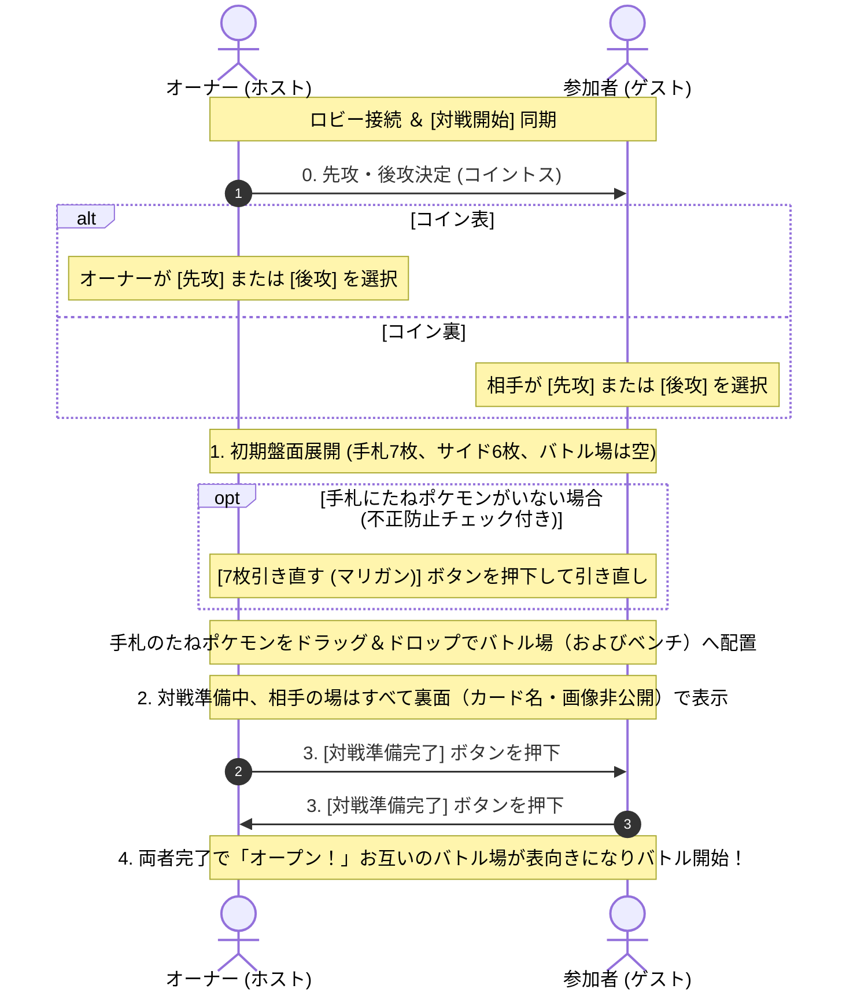

# ポケモンカード オンライン対戦ツール 仕様書

本書は、Webブラウザ上で動作するポケモンカードゲーム（ポケカ）の2人対戦用オンラインシミュレーターに関する総合仕様書です。

---

## 1. プロジェクト概要

### 1.1 目的・コンセプト
- **手動操作型オンラインシミュレーター**:
  システムの複雑な自動ルール判定（カードテキスト自動処理や効果の自動強制）を排し、実際の紙のカード対戦と同様に**プレイヤー双方がカード移動・ドロー・エネルギー装着・ダメカン管理などの操作を直感的に行いながら対戦を進める方式**を採用します。
- **直感的なドラッグ＆ドロップとレスポンシブ操作**:
  PCではマウスによるドラッグ＆ドロップや範囲選択、スマホでは片手で扱えるハンバーガーメニューUIにより、デバイスを問わずスムーズに対戦できます。

### 1.2 コア要件
1. **完全サーバーレス / クライアント完結**: HTML5 / CSS3 / Vanilla JavaScript のみで構成（ビルド不要・静的ホスティング可能）。
2. **アカウント不要・DB不要**: ユーザー登録や個人情報の保存を行わず、プライバシーと手軽さを最優先。
3. **オンライン対戦（Firebase Realtime Database）**: ルーム番号を共有することでFirebaseを介して盤面状態をリアルタイム同期。学校・会社・スマホ回線などあらゆるネットワーク環境で100%接続可能。
4. **公式デッキコード対応**: 公式サイトで作成したデッキコードからカードリスト（カード名・枚数・種別）を展開。
5. **完全試合再現CSV**: 対戦中の全ステップ（盤面スナップショット付き）をCSV出力し、後から読み込んで完全に試合を再生可能。
6. **カスタムプレイマット対応**: 画面半分ずつの背景表示、10種類のプリセット、自作画像の登録（localStorage保存）。

---

## 2. 画面構成およびUI仕様

システムは大きく **① ロビー画面（接続・デッキ・プレイマット選択）** と **② 対戦画面（プレイマットUI）** で構成されます。

### 2.1 画面①：ロビー画面 (Lobby & Setup)


#### 主な特徴・構成要素
1. **ビジュアルデザイン**:
   - 明るく爽やかな晴天・ポケカスタジアムをイメージした水色と白のグラデーション背景。
   - 中央に白基調のすりガラス（グラスモーフィズム）パネルを配置。
   - **4隅のかわいいポケモン（ゆらゆら揺れるアニメーション）**:
     - 左上: **ピカチュウ**（⚡ ピカッ！）
     - 右上: **イーブイ**（🌟 ブイブイ♪）
     - 左下: **ポッチャマ**（💧 ポチャ♪）
     - 右下: **プリン**（💖 プププ♪）
     - CSSキーフレームにより、固定位置（`position: fixed`）でゆらゆらと浮遊・揺れる演出を実装。
2. **最上部モード切替タブ（オンライン対戦 vs 一人回し）**:
   - `[🌐 オンライン対戦]`: 相手プレイヤーとのマッチングまたはBOTとの練習対戦。
   - `[🃏 一人回し]`: 自分の手で2つのデッキを操作し、ターン終了ごとに上下視点を交代しながらじっくりカードを回せる研究・練習モード。
3. **入力・選択ステップ（オンライン対戦時）**:
   - **Step 1: あなたの名前**: プレイヤー名入力（初期値: プレイヤーA）。
   - **Step 2: ルーム**: `[ルームを作る]`（6桁自動生成・コピー付き）または `[ルームに入る]`（番号入力）。
   - **Step 3: デッキコード**: コード入力＋`[読み込む]`。デッキ内訳（ポケモン/トレーナーズ/エネルギー）のプレビュー表示。
   - **Step 4: あなたのプレイマット選択**:
     - 10種類のプリセットから横スクロールで選択。
     - `[＋ 自作マット登録]` ボタンから端末内の画像（PNG, JPG, WebP）を名前付きでアップロード（localStorage保存）。
     - ※相手側のマットは相手プレイヤーが自身で選択します。
   - **対戦開始**: `[対戦開始]` ボタン。画面下までスムーズにスクロールして押下可能。
   - **試合再現**: `[📂 試合ログ(CSV)を読み込んで試合を再現]` ボタン。過去のCSVを読み込んで即座にリプレイを開始。
4. **入力・選択ステップ（一人回し時）**:
   - **Step 1: デッキ1 (先攻側 / あなた)**: デッキコード入力＋`[読み込む]`。プレビュー表示。
   - **Step 2: デッキ2 (後攻側 / 対戦相手)**: デッキコード入力＋`[読み込む]`。プレビュー表示。
   - **Step 3: プレイマット選択**: 背景プレイマットを選択。
   - **`[一人回しを開始する]`**: 2デッキ分（計120枚）が同時に山札・手札・サイド・バトル場にセットアップされ、対戦画面へ遷移。
   - **ターン交代時の上下反転**: 一人回し中、`[ターン終了]` ボタンを押すと**自分側（下）と相手側（上）の全カード（手札、バトル場、ベンチ、山札、サイド、トラッシュ、ロスト）が完全に入れ替わり**、常に操作する側が手前で手札を広げて操作できます。

---

### 2.2 画面②：対戦画面（Battle Arena）


#### 盤面レイアウト（PTCGL準拠）
対戦盤面は中央境界線を境に上下に分かれ、相手側（上半分）は180度反転したリアルな対面視点で配置されます。

```
+-------------------------------------------------------------------------------------------------------+
| [相手手札 (上端から裏面)]                                    [ROOM番号] [退室]                          |
+-------------------------------------------------------------------------------------------------------+
| 【相手エリア】(180°反転)                                                                              |
|  [相手ロスト]              [相手ベンチ (最大5枠)]                       [相手山札]                    |
|  [相手サイド(6枚)]         [相手バトル場]                               [相手トラッシュ]              |
+-------------------------------------------------------------------------------------------------------+
| 【中央アリーナ】                                                                                      |
|  [使用カードエリア] (常時表示枠)    [相手バトル場スポット]     [共有スタジアム] (中央右寄り)          |
|  ※ドラッグで配置                   [自分バトル場スポット]     ※ドラッグ＆ドロップ対応                |
|  ※操作ボタン自動出現                                                                                  |
|  --------------------------------- [中央境界線 (破線)] --------------------------------------------- |
|  [操作ボタン] ログ / コイン / CSV出力 / 再現                                                          |
|  [ターンパネル] 相手名 / あなた名 / ターン数 / [ターン終了]                                           |
+-------------------------------------------------------------------------------------------------------+
| 【自分エリア】                                                                                        |
|  [自分サイド(6枚)]         [自分ベンチ (最大5枠)]                       [自分山札 (残り枚数)]         |
|  [自分ロスト]              [自分バトル場]                               [自分トラッシュ]              |
|                                                     【テンポラリエリア】                              |
|                                                     [引いたカード] [手札へ] [山下へ]                  |
+-------------------------------------------------------------------------------------------------------+
| 【手札エリア】(最下部固定)                                                                            |
|  [手札操作ボタン群] 1枚引く / 山を見る / 山に戻す / 山下へ / トラッシュ / ロストへ / ベンチに出す       |
|  [手札カード一覧] (ドラッグ可能・クリックトグル選択・矩形ドラッグ範囲選択対応)                        |
+-------------------------------------------------------------------------------------------------------+
```

---

## 3. 主要機能・詳細仕様

### 3.1 プレイマット画面半分背景表示 & 自作登録
1. **画面半分ずつの背景表示**:
   - 盤面背景に `.board-mat-container` を配置。
   - **上半分**: 相手が選択したプレイマット（180度回転して対面向きに表示）。
   - **下半分**: **自分が選択したプレイマット**（自作画像も `background-size: cover` で綺麗に全面表示）。
   - 盤面上のカードや文字が埋もれないよう、薄い半透明レイヤーを重ねて高い視認性を確保。
2. **10種類のプリセット**:
   - クラシック・ネイビー、クリムゾン・レッド、エメラルド・フォレスト、ライトニング・ボルト、サイキック・シャドウ、ダークネス・アビス、チャンピオン・ゴールド、アクア・ラグーン、ロスト・ディメンション、プラチナム・スチール。
3. **自作プレイマット登録（localStorage）**:
   - 画像ファイル選択時に名前を付けて登録。
   - `localStorage` にBase64形式で保存され、次回アクセス時もそのまま利用可能。
   - 自作カード右上の「×」ボタンから削除可能。

---

### 3.2 使用カードエリア（常時表示・ドラッグ配置）
- **常時表示スロット**:
  中央バトル場の左寄りに「使用カード枠」として常時スロット枠を表示。
- **ドラッグ＆ドロップ操作**:
  手札から使いたいカードを直接ドラッグ＆ドロップして配置（手札選択後にエリアクリックでも可）。
- **リアルタイム通知**:
  カードが置かれた瞬間、ログおよび相手画面に「○○が【○○カード】を使用しました」と明示通知。
- **操作アクションボタン（配置時に出現）**:
  - `[使用完了（トラッシュへ）]`: 効果処理完了後、トラッシュへ移動。
  - `[手札に戻す]`: プレイをキャンセルして手札へ回収。
  - `[スタジアムに出す]`: スタジアムカードの場合、スタジアム場へ直接配置。
  - `[ロストへ]`: ロストスイーパー等の効果でロストゾーンへ送る。

---

### 3.3 スタジアムエリア（ドラッグ配置・共有）


- 中央ライン右寄りに配置。手札または使用カードエリアから直接**ドラッグ＆ドロップ**で場に出すことが可能。
- ドラッグホバー時には水色の発光枠でドロップ先を明示。
- 既にスタジアムがある状態で新しいスタジアムを出すと、古いスタジアムは自動的にトラッシュへ送られます。
- クリックでトラッシュ確認メニュー、ダブルクリックで拡大表示が可能。

---

### 3.4 エネルギーおよびポケモンのどうぐ（ドラッグ付与・表示）
1. **ドラッグ＆ドロップ装備**:
   - 手札のエネルギーカードやポケモンのどうぐを、バトル場またはベンチのポケモンへ直接ドラッグ＆ドロップして装備。
2. **エネルギーの小さな丸（バッジ）表示**:
   - ポケモンカード下部に、エネルギー属性に応じたカラー（炎=赤, 水=青, 草=緑, 雷=黄, 超=紫, 闘=橙, 悪=黒, 鋼=灰, 特殊=白）の丸いバッジで表示。
   - **移動**: バッジを別のポケモンカードへドラッグ＆ドロップして付け替え可能。
   - **クリックメニュー**: 「トラッシュする」「手札に戻す」「山に戻す」から選択可能。
3. **ポケモンのどうぐ表示**:
   - ポケモンカードの上部に少しはみ出る形で、どうぐの名前とアイコンを表示。
   - クリックメニューで「拡大表示」「トラッシュする」「手札に戻す」「ロストへ」を選択可能。

---

### 3.5 カードダブルクリック拡大機能
- **表になっている全カードが対象**:
  - 自分の手札、自分/相手のバトル場、自分/相手のベンチ、スタジアム、使用カードエリア、テンポラリエリア、トラッシュ最上部。
- カードをダブルクリックすると中央に大きくポップアップ表示。
- ポケモンカードの場合、現在付いている**エネルギー一覧（色・アイコン・名前）**および**ポケモンのどうぐ**が下部にわかりやすく一覧表示されます。

---

### 3.6 手札の複数選択 ＆ 範囲ドラッグ（マーキー）選択
1. **クリックトグル選択**:
   - 手札カードをクリックすると選択、もう一度クリックすると解除。
   - 複数枚を同時に選択可能。右下に「選択中: ○枚」を表示。
2. **マウスドラッグによる矩形範囲選択（マーキー選択）**:
   - 手札エリア内の余白やカード上をドラッグすると青い半透明の選択矩形が表示され、触れたカードをまとめて一括選択。
3. **複数カードの一括アクション**:
   - 選択した複数枚の手札を、`[手札を山にもどす]` `[山の下に戻す]` `[トラッシュする]` `[ロストへ送る]` `[ベンチに出す]` で一度に操作可能。

---

### 3.7 山札ポップアップの操作強化
- 山札の `[山を見る]` をクリックして開くモーダルにおいて:
  - 各カードに個別の `[手札に加える]`（緑）および `[トラッシュ]`（赤）ボタンを配置。
  - カードクリックで複数選択し、フッターから `[選択を手札に加える]` `[選択をトラッシュ]` で一括移動可能。

---

### 3.8 試合ログのCSV出力 & 完全試合再現（リプレイモード）

#### CSVファイル出力仕様
- **Excel文字化け防止**: UTF-8 BOM（`\uFEFF`）付きで出力。
- **ファイル名**: `pokeca_match_<ルーム番号>_<日時>.csv`
- **カラム構成**:
  1. `Step`: アクション通番（1〜）
  2. `Turn`: ターン数
  3. `Timestamp`: ISO 8601形式の時刻
  4. `Player`: 操作プレイヤー名
  5. `Action`: 操作識別子（`MATCH_START`, `HAND_TO_PLAY`, `ATTACH_ENERGY`, `DRAW_CARD`, `END_TURN` 等）
  6. `CardName`: 対象カード名
  7. `FromZone`: 移動元ゾーン
  8. `ToZone`: 移動先ゾーン
  9. `Details`: 補足詳細
  10. `LogMessage`: 対戦ログメッセージ
  11. `Snapshot`: **盤面完全状態JSON**（全ゾーンのカード、HP・ダメカン、エネルギーバッジ一覧、どうぐ、選択プレイマットID）

#### CSVインポートによる試合再現（リプレイコントローラー）
- ロビーの `[📂 試合ログ(CSV)を読み込んで試合を再現]` または対戦中の `[再現]` ボタンからCSVを読込。
- **リプレイバー（画面上部）**:
  - `⏮`: 初手（Step 1）へジャンプ
  - `◀`: 前の手へ1ステップ巻き戻し
  - `▶ 再生 / ⏸ 一時停止`: 1.2秒間隔で次ステップを自動再生
  - `▶`: 次の手へ1ステップ進行
  - `⏭`: 最終手へジャンプ
  - **シークバー（スライダー）**: 任意の手数に瞬時にスクラブ移動
  - **ステップ表示 / ログメッセージ表示**: 現在の手順のログを逐次表示
  - `[再現終了]`: リプレイを終了して通常モードへ復帰

---

### 3.9 スマホ対応（タッチ操作D&D ＆ 手札選択ボトムメニュー）

1. **タッチ操作ドラッグ＆ドロップ**:
   - スマホ・タブレット等のタッチデバイスにおいて、HTML5標準DnDが動作しない問題を解決する専用タッチドラッグエンジンを搭載。
   - **指でのタッチドラッグ対象**:
     - **手札カード**: 指でドラッグして「使用カードエリア」「バトル場（空き/進化/エネ付与）」「ベンチ各枠（空き/進化/エネ付与）」「スタジアム」「トラッシュ」「ロストゾーン」「山札」へ直感的に配置・移動可能。
     - **ついているエネルギー（小さな丸バッジ）**: 指でドラッグして別のポケモンへ付け替え、またはトラッシュへ移動可能。
     - **使用中カード**: トラッシュ、手札、スタジアム、ロストへドラッグ移動可能。
     - **スタジアムカード**: トラッシュへドラッグ移動可能。
   - **視覚的フィードバック**:
     - 指の移動に追従する半透明カードアバター（シャドウ＆ゴールド枠）を表示。
     - ドロップ可能なエリア（バトル場、ベンチ枠、トラッシュ等）へ指が重なると、黄色点線のハイライト枠（`.touch-drop-hover`）でドロップ可能であることを明示。

2. **手札カード選択時のボトムメニュー自動展開**:
   - スマホモード（縦画面または画面幅768px以下/タッチ端末）時、手札のカードをタップすると**即座に下からボトム操作シート（`.sp-sheet`）が自動展開**。
   - **カード種別ごとの専用操作ボタン群**:
     - 選択中カード名・種別（たね/進化/グッズ/サポート/エネ）・HPのプレビューバナーを表示。
     - `[🃏 使用カードエリアへ (使う)]`
     - `[⚔️ バトル場に出す]`（バトル場が空き、または進化可能な場合）
     - `[🪑 ベンチに出す]`（空きベンチ枠へワンタップで配置）
     - `[⚡ エネルギーをつける]`（バトル場、ベンチ1〜5の候補ボタンを一覧表示し、タップで即付与）
     - `[🎒 どうぐをつける]`（対象ポケモンの候補ボタンを表示）
     - `[🏟️ スタジアムとして場に出す]`（スタジアムカード時）
     - `[🗑️ トラッシュする]` / `[🌌 ロストへ送る]`
     - `[🔄 山札の上に戻す]` / `[⬇️ 山札の下に戻す]`
     - `[🔍 カードを拡大表示]` / `[✖️ 選択解除して閉じる]`
   - **複数選択時のまとめ操作**:
     - 複数カード選択時は `[🗑️ 選択したN枚をトラッシュ]` `[🌌 ロスト]` `[🔄 山札上]` `[⬇️ 山札下]` `[🪑 選択したポケモンをベンチへ]` がまとめて実行可能。
   - **ハンバーガーボタン（`[操作]`ボタン）**:
     - 右下の常駐フローティングボタンからもいつでもメニュー開閉可能（山札ドロー、山を見る、シャッフル、ターン終了、ログ、コイン、CSV出力/再現など）。

---

### 3.11 対戦準備フェーズ仕様 (Match Setup Phase)

ロビーで対戦開始を押して両者が同期した後、公式ルールに準拠した以下の「対戦準備フェーズ」を盤面上で行います。



#### フェーズ詳細仕様

0. **先攻・後攻の決定（コイントス ＆ 選択権）**:
   - ルーム作成者（オーナー）の画面でコイントスを実行。
   - **表が出た場合**: オーナーに先攻・後攻選択モーダルが表示され、「先攻」または「後攻」を決定。
   - **裏が出た場合**: 相手プレイヤー（ゲスト）に選択モーダルが表示され、相手が「先攻」または「後攻」を決定。
   - 決定結果が双方に同期され、「○○が【先攻】、○○が【後攻】になりました」と通知。

1. **手札7枚・サイド6枚展開 ＆ バトル場空（手動配置・マリガン判定）**:
   - 初期手札7枚、サイド6枚をセット。**バトル場には自動でポケモンを置かず、空のスロットとして開始**。
   - **手札にたねポケモンがいる場合**:
     - 手札からドラッグ＆ドロップ（またはタップメニュー「⚔️ バトル場に出す」）でバトル場へ配置。
     - ※この時、手札にたねポケモンがいるため「7枚引き直す」ボタンは非活性（不正防止）。
   - **手札にたねポケモンが1枚もいない場合（マリガン）**:
     - 「7枚引き直す（マリガン）」ボタンが活性化。
     - 押下すると手札7枚を山札に戻して自動シャッフルし、新たに7枚を引き直す（相手にもマリガン通知が送信される）。

2. **対戦準備中のカード秘匿（裏向き非公開）**:
   - 対戦準備フェーズ中、自分がバトル場やベンチに出したポケモンは、**相手の画面上では「裏向きカード（back）」として表示**され、どのポケモンを出したかは相手に見えません。

3. **対戦準備完了ボタン**:
   - バトル場にたねポケモンを配置すると、「対戦準備完了」ボタンが活性化。
   - 押下すると「相手の準備完了を待っています...」状態になり、相手へ準備完了シグナルを送信。

4. **バトル開始（オープン）**:
   - 双方のプレイヤーが準備完了となった瞬間、**「せーの、オープン！」** の演出とともに相手と自分のバトル場・ベンチのポケモンが表向きになり、実カード名と画像が公開。
   - 対戦準備フェーズが終了し、通常の第1ターン（先攻側プレイヤーのターン）へとシームレスに移行。

---

## 4. 特殊状態・ベンチ拡張・対戦演出機能仕様 (v7.0)

### 4.1 特殊状態（状態異常）仕様
- **特殊状態の操作とトグル**:
  - ポケモン選択時のメニュー「特殊状態」から「どく」「やけど」「まひ」「こんらん」「ねむり」を個別に付与可能。
  - すでに該当の状態異常になっている場合、ボタン表記は「○○を治す」に変化し、ワンクリックで解除可能。
  - ポケモンチェックにおけるダメージ（どく+10、やけど+20）は手動ダメカン増減ボタンで運用。
- **視覚エフェクト**:
  - **どく**: 紫色の泡がぷくぷく立ち上るパーティクルエフェクト。
  - **やけど**: 赤と橙の炎がゆらめき立ち上る燃焼エフェクト。
  - **まひ**: 黄色の電撃・スパークが走るビリビリエフェクト。
  - **こんらん**: ポケモンの頭上を星が回転するぐるぐるエフェクト。
  - **ねむり**: 浮遊する「Zzz」エフェクト。
- **自動回復ルール**:
  - ポケモンがベンチへ戻った時（にげる・いれかえ時）はすべての特殊状態が自動回復。
  - ポケモンが進化した時もすべての特殊状態が自動回復。

### 4.2 相手ポケモンに対するコンテキストメニュー
- 相手のバトル場・ベンチポケモンをクリックした際にもコンテキストメニューを展開可能。
- ダメカン操作（+10, +50, +100, -10, -50, -100）、特殊状態の付与/解除、相手ベンチポケモンをバトル場へ呼び出す（「ボスの指令」等）、相手ポケモンのトラッシュ/手札戻し操作に対応。

### 4.3 ターン進行表示・スライド演出・強制トップドロー
- **ターン表記**: 「先攻1ターン目」「後攻1ターン目」のように先攻・後攻で各1ステップ進行する正式ルール表記。
- **ターン表示インジケーター**: 画面右のプレイヤー名において、手番中のプレイヤー名の左側に「赤丸インジケーター」を表示。右側に「先攻」「後攻」バッジを常時表示。
- **ターン開始スライドバナー**: バトル開始時およびターン交代時に、画面右から「○○のターン（ターン数）」がスライドインし、中央で2秒静止したあと左へフェードアウトする演出。
- **強制トップドロー ＆ スポットライト**:
  - 自分のターン開始時、山札から自動で1枚トップドロー（山札が0枚の場合は敗北判定）。
  - スライドバナー終了直後、引いたカードが画面中央に大きくスポットライト拡大表示され、引いたカードを確認可能。

### 4.4 ベンチ枠数拡張 (5枠 ⇔ 8枠)
- ベンチ枠内に「ベンチ枠を8にする」ボタンを配置。クリックでベンチ枠が最大8枠に拡張。
- 8枠時は「ベンチ枠を5にする」ボタンが表示。ベンチにポケモンが6匹以上いる状態で5枠へ縮小しようとすると、トラッシュ選択モーダルが表示され、超過分をトラッシュするまで確定不可。

### 4.5 勝利演出
- サイド取りきり等の勝利時、金色のトロフィー、回転する「VICTORY!!」バナー、画面全体に降り注ぐ紙吹雪・クラッカー花火パーティクルがド派手に発動。

### 4.6 プレイエラー巻き戻し（Undo）機能
- 画面上部ヘッダー（ROOM情報右横）に「↩️ 1手順巻き戻す」ボタンを常時配置。
- ドロー、手札からの配置・進化・エネルギー付与、トラッシュ、バトル場交代、ダメカン操作などの直前に盤面スナップショット（直近15手順）を自動保存。
- ボタン押下で1手前の盤面状態（山札・手札・サイド・バトル場・ベンチ・トラッシュ・ロスト・使用カード）を復元し、対戦相手側にも即時P2P同期送信。

### 4.7 特性使用済みマーク ＆ ターン終了時リセット
- コンテキストメニューから「✨ 特性を使う」を実行した際、対象ポケモンのカード右上に紫色コンパクトバッジ「済」を常時表示（同メニューからトグル解除も可能）。
- 「ターン終了」ボタン押下時（および手番交代の受信時）に、バトル場およびベンチの全ポケモンの特性使用済みマークを一括消去。
- **進化時の自動解除**: ポケモンが進化した際、進化前の特性使用済み状態は自動的にクリア（`abilityUsed = false`）され、「済」バッジも即座に消去。

### 4.8 進化時の確認ポップアップ
- ポケモンを手札から重ねて進化させようとした際、「『【現在のポケモン名】』を『【進化先カード名】』に進化させますか？」の確認ダイアログを表示。
- 進化実行時は特殊状態が自動回復し、特性使用済みマークもリセット。キャンセル時は進化を中断し、手札のカードをそのまま手元に維持。

### 4.9 コンテキストメニュー見切れ防止
- 画面下端近くにあるベンチポケモンをクリックした際、メニューが画面下端をオーバーする場合はカーソルより上方向へ自動反転展開。
- メニュー全体に `max-height: calc(100vh - 24px)` および縦スクロールバー（`overflow-y: auto`）を適用し、低解像度環境でもボタンが画面外に見切れる問題を完全に防止。
- 最も頻繁に使う「⚔️ バトル場に出す / 🔄 バトル場と交代」ボタンをメニュー最上部に優先配置。

### 4.10 手札右クリックコンテキストメニュー
- 手札カードのダブルクリックは従来の「拡大表示」のまま維持。
- 手札カードを右クリックした際に専用の操作メニューを展開：
  - 📢 **使用する**（画面中央の使用カードエリアへ出す）
  - ⚔️ **バトル場に出す**（※たねポケモン判定の制限なく配置可能）
  - 🪑 **ベンチに出す**（※たねポケモン判定の制限なく配置可能）
  - ✨ **重ねて進化させる対象を選択**
  - ⚡/🎒 **ポケモンにつける対象を選択**
  - 🗑️ **トラッシュ** / 🌌 **ロストゾーン** / 🔄 **山札の上** / ⬇️ **山札の下**
  - 🔍 **カードを拡大表示**
- 画面端での見切れ対策（上向き・左向き反転展開）を標準搭載。

### 4.11 マリガン確認手札の画像表示 ＆ 誤消失防止
- 相手のマリガン手札確認モーダルにおいて、全カードを高解像度画像付きで確実に表示。
- 背景の暗転エリアをクリックしても確認モーダルが勝手に閉じないよう保護（必須ダイアログ保護）。
- 未確認のマリガン手札がある間は、準備バナーに「⚠️ 相手のマリガン確認待ち (開く)」ボタンを常時表示し、ブラウザ復帰時（`window.focus`）にも自動で確認モーダルを最前面に復帰。

### 4.12 ダメカン連打操作対応 (v9.0)
- ダメカン操作サブメニュー（`+10`, `-10`, `+50`, `+100`, `リセット`）を押した際、メニューを閉じずに開いたまま維持。
- クリックするごとにリアルタイムでダメカン数値を盤面に反映し、メニューヘッダーの「現在: ○○」表示も即座に更新。
- サブメニューヘッダーの「✖」ボタンおよび下部の「✖ 完了（閉じる）」ボタン、またはメニュー外クリックによりいつでも完了可能。
- 相手ポケモンのダメカン調整サブメニューも同様に連打可能。

### 4.13 手札右クリックメニューの付与対象名ホバー表示 (v9.0)
- 手札の右クリックメニュー内「ポケモンにつける対象」「重ねて進化させる対象」のボタンにおいて、マウスオーバー（ホバー）時に完全な対象名とHP（例: `ベンチ1: かがやくゲッコウガ (HP130)`）が浮き出るカスタムツールチップおよびボタン展開表示を実装。
- ブラウザ標準の `title` 属性も完備し、いかなる画面解像度でも付与対象の判別が容易。

### 4.14 テンポラリエリアのカード個別選択と移動操作 (v9.0)
- 山札からドローしたカードが置かれるテンポラリエリアにおいて、各カードをクリックで選択/解除可能（`.selected`による金色発光枠 ＆ `✔ 選択中`バッジ表示）。
- **個別移動**: 1枚以上選択されている場合、右側の操作ボタン（手札に加える・山札の上に置く・山札の下に送る・トラッシュ）は「選択されたカードのみ」を対象として移動。
- **一括移動**: カードが未選択の場合は、従来通りテンポラリエリア内の全カードを一括で移動。
- ボタンラベルも選択状態に応じて「手札に加える (選択1枚)」や「手札に加える (すべて)」と動的に表示が切り替わる。

### 4.15 全フィールドの操作系統一 (v9.0)
- 手札、自分バトル場、自分ベンチ、相手バトル場、相手ベンチの操作ルールを統一：
  - **左クリック（Click）**: カードの選択・フォーカス（青色発光枠 `.field-selected` のトグル表示）。
  - **ダブルクリック（DblClick）**: カードの拡大表示モーダル（`openCardZoom`）を開く。
  - **右クリック（Context Menu）**: ポケモン操作コンテキストメニューを表示。
  - ※スマートフォンやタッチ環境では、タップ時に自動でメニューを展開しタッチ操作性を維持。

### 4.16 ド派手な山札シャッフル演出 (v9.0)
- 山札シャッフル（`shuffleMyDeck`）実行時、山札位置から複数のカード束が空中へ勢いよく舞い上がるド派手な3Dリッフルシャッフルエフェクトを発動。
- 左右に分かれたカードパックが激しく交差・回転したのち、黄金のフラッシュバーストとともに山札へ収束。
- 中央に立体的な「🔀 SHUFFLE!!」バッジがダイナミックにポップアップし、WebRTC通信を通じて対戦相手の画面でも同期して再生。

### 4.17 バトル場不在時の出撃選出フェーズ・操作ロック・敗北判定 (v9.1 / v10.0)
- **ターン開始時のバトル場不在チェック**:
  - ターン交代バナー演出終了後（または強制トップドロー直前）に、手番プレイヤーのバトル場が空（`state.myActive === null`）であるかを自動検証。
- **ベンチにポケモンがいる場合（出撃選出フェーズ・操作ロック）**:
  - カードを引く前（トップドロー前）に**「出撃選出フェーズ」**へ移行（`state.mustPromoteToActive = true`）。
  - 背景クリックで閉じないモーダル（`showPromoteActiveModal`）を表示し、ベンチにいるポケモン一覧（画像・エネ・どうぐ・ダメカン付き）から出撃させるポケモンを選択。
  - **完全な操作ロック**: 出撃するポケモンを決定するまで、山札ドロー、手札カード使用、コンテキストメニュー表示、ターン終了などの盤面操作を完全ブロック。ターン終了ボタンも「出撃待ち」となり非活性化。
  - 出撃ボタン押下後、選ばれたベンチポケモンがバトル場へ出撃し（`swapActiveBench`）、操作ロックが解除された後、通常の**ターン開始トップドローフェーズ**へ自動的に進む。
- **ベンチにポケモンがいない場合（敗北判定）**:
  - バトル場が空かつベンチにもポケモンが1匹もいない場合、ルールに基づき**「負け（Defeat）」**が即座に確定。
  - 対戦ログに敗北を記録し、P2P対戦時は相手へ勝利通知（`t: "victory"`）を送信。
  - 自分画面では対戦決着・敗北演出画面を表示し、相手側では勝利演出（紙吹雪・トロフィー）を表示。

### 4.18 マリガン差分ドロー・スマホ最適化・ホバー安定化・サイド右クリック (v11.0)
- **マリガンペナルティ（差分ドロー）**:
  - お互いの対戦準備完了（バトル場・ベンチ配置＆サイド6枚セット）後、対戦開始直前にマリガン回数の差分を自動判定。
  - 相手のマリガン回数が自分のマリガン回数より多い場合、差分枚数を上限として「山札からカードを引きますか？」の確認ダイアログを表示。
  - 「はい、引きます」選択で差分枚数を山札からドローし相手に同期。「引かない」選択でそのまま開始。お互い同数の場合は差分0のため追加ドローなしで直ちに対戦開始へ移行。
- **カード名・種類の帯非表示化（イラスト全開表示）**:
  - 画像付きカード（`.has-img`）において、カード上部の名前バーおよび下部の種類バーを非表示化し、実物カード・PTCGL同様にイラスト全体をクリアに表示。
- **スマホ版ベンチ配置のPTCGL準拠化**:
  - 2段折り返し（3+2）を撤廃し、PTCGLスマホ版に準拠した横1列スマート配置（横スクロール対応）に変更。ベンチ拡張ボタンの重なりも解消。
- **カードホバー時のプルプル振動防止**:
  - 手札カードホバー時に下方向の透明ヒット領域（`::after`）を展開し、非全画面時や画面縮小時に発生する境界判定の無限ループ（Hover Jitter）を完全防止。
- **サイドカードの右クリックコンテキストメニュー**:
  - サイドカードに `oncontextmenu` を実装。右クリックで「手札に加える」「表を確認する（拡大表示）」「山札に戻す」「トラッシュ」「ロストゾーン」を選択可能に。PC左クリックは直感的にサイド取得、スマホはタップでメニュー表示。

### 4.19 8枠ベンチ配置制限解除 ＆ スマホ版ベンチ2段表示（PTCGL準拠） (v11.1)
- **8枠ベンチへの配置制限解除**:
  - `myBenchLimit = 8` 設定時、手札アクション（`placeHandCardToBenchIndex`）や先頭空き枠検索（`placeHandCardToFirstEmptyBench`）、手札複数選択配置（`placeSelectedHandToBench`）、およびタッチ/マウスD&D（`touch-dnd.js`）において、従来ハードコードされていた「5枠制限（`benchIdx >= 5`）」を撤廃。`state.myBenchLimit`（最大8枠）まで正常に配置・ドラッグ＆ドロップ可能に改修。
  - 初期化処理（`setup.js`）において `state.myBench` および `state.oppBench` の配列長を常に8スロット確保。
- **スマホ版ベンチ表示の2段化（PTCGLモバイル版準拠）**:
  - スマホ縦画面・狭小画面において、PTCGLモバイル画面に準拠した2段グリッドレイアウトを採用。
  - **通常時（5枠モード）**:
    - 前列3枠・後列2枠（前3・後2）の台形センタリング配置。
    - 自分ベンチ: 前列（バトル場側・上段）にベンチ1・2・3、後列（手札側・下段）にベンチ4・5を中央寄せ配置。
    - 相手ベンチ: 前列（バトル場側・下段）にベンチ1・2・3、後列（相手側・上段）にベンチ4・5を中央寄せ配置。
  - **拡張時（8枠モード）**:
    - 前列4枠・後列4枠（前4・後4）の2段配置。
    - 自分ベンチ: 前列（上段）にベンチ1〜4、後列（下段）にベンチ5〜8を等幅配置。
    - 相手ベンチ: 前列（下段）にベンチ1〜4、後列（上段）にベンチ5〜8を等幅配置。
  - カードおよびスロットの高さ・縦横比を最適化し、22vhのバンド領域内に収めつつ視認性とタップ/ドラッグ操作性を大幅に向上。空きスロット内の補助テキスト（ドラッグ配置等）をスマホでは非表示にしてレイアウト崩れを防止。
- **カードホバー時のプルプル振動（Jitter）の根本解決**:
  - 原因調査: `.hand-cards` に設定されていた `overflow: hidden` により、カードがホバーで上に移動（`translateY`）した際に上部および下部のヒット判定拡張領域（`::after`）がコンテナ枠外でクリップされ、狭小画面・非全画面時に秒間数十回のオン/オフ判定ループ（Jitter）が発生していた。
  - 対応:
    1. `.hand-cards` の `overflow: hidden` を `overflow: visible` に変更し、上下のクリッピングを解除。
    2. PC大画面（デスクトップ）では `::after` を全方位クッション（`inset: -10px -6px -28px -6px`）に強化し、マウス移動時の追随性を担保。
    3. スマホ・狭小画面（`max-width: 768px` / 縦画面）では、狭い手札エリア内での垂直移動自体を抑止（`transform: none !important`）し、代わりに美しいゴールド・ブルーの二重発光ハイライト（`box-shadow` & `filter` & `outline`）を適用することで、物理的に振動が起きない完全な安定化を実現。

### 4.20 一人回しツールの双方対戦準備（手動切替・マリガン）および相手手札干渉機能 (v12.0)
- **背景と課題**:
  1. 従来の一人回しツールでは、開始時にデッキ2（相手側）が自動でたねポケモンをバトル場に出し、サイド6枚を自動配置していたため、デッキ2側の手札確認・たねポケモン選定・ベンチ配置・マリガンなどの対戦準備フェーズをプレイヤー自身で行うことができなかった。
  2. ポケカ実戦では「ナンジャモ」「ジャッジマン」「ツツジ」等の相手手札を山札に戻して引き直させる手札干渉カードが頻出するが、従来は相手手札が裏面かつ操作不能であったため、一人回しでこれらを再現することが困難であった。
- **機能仕様**:
  1. **双方の完全手動対戦準備**:
     - 一人回し開始時、デッキ1（先攻）とデッキ2（後攻）の双方が手札7枚のみを引き、バトル場・ベンチ・サイドは空の状態で準備フェーズが開始。
     - **準備側切り替えボタン（`🔄 側を交代`）**: 対戦準備バナー内に配置。いつでもデッキ1とデッキ2の視点を切り替え（上下反転）、手札を見ながらバトル場やベンチへの配置を行うことが可能。
     - **個別マリガン**: 各デッキごとにたねポケモンがいない場合、そのデッキの視点において「たねなし引き直し（マリガン）」が可能。マリガン回数はデッキ個別に記録される。
     - **個別準備完了**: バトル場にたねポケモンを出した状態で「✅ 準備完了」を押すと、そのデッキにサイド6枚がセットされる。まだ相手側が準備完了していない場合は自動的に相手側のセットアップ視点へ切り替わる。準備完了後も取り消しが可能。
     - **マリガン差分ドローの適用**: 双方の準備が完了した際、マリガン回数に差がある場合は、回数が少なかった側のプレイヤーに対して公式ルールに基づく差分ドロー確認ダイアログが発火。
     - **先攻側配置での対戦開始**: どちらのデッキが最後に準備完了を押しても、対戦開始時には必ず先攻（デッキ1）が下側（手前）になるよう自動調整。
  2. **相手手札干渉（テーブルトップ式手動操作）**:
     - 固有カード名のハードコードを排し、あらゆる手札干渉効果を汎用的に解決できるテーブルトップ操作メニューを提供。
     - **起動方法**:
       - 画面上部の相手手札（裏面カード列または手札枠）をクリック。
       - または手札エリア横の「🎴 相手手札干渉」ボタン、スマホの操作メニュー（未選択時）から開く。
     - **提供機能**:
       - 🔀 **相手手札をすべて山札に戻してシャッフル**: 相手の手札をすべて相手山札に合流させ、自動シャッフル。
       - ⬇️ **相手手札をすべて山札の下に戻す**: 相手の手札をそのまま相手山札の一番下に送る（ナンジャモ等の解決用）。
       - 📥 **相手山札からカードを引く（ドロー）**: 「1枚」「サイド枚数分」「4枚」「2枚」「任意枚数」からワンタップで相手山札から相手手札へカードを引く。
       - 🗑️ **相手手札をすべてトラッシュする**: 相手手札をすべて相手トラッシュへ送る。
       - 🔄 **相手側と一時交代（手動操作モード）**: ターンを進めずに一時的に上下を反転。相手の手札を広げた状態で1枚ずつ確認・選択・手動操作（任意のカードだけ山下へ送る、トラッシュするなど）が可能。操作中は「⚠️ 【相手側を手動操作中】」の黄色いバナーが表示され、ターン終了ボタンがロックされる。「🔄 手番側に戻る」を押すことで安全に元の手番側へ復帰できる。
  3. **オンライン対戦との完全分離**:
     - すべての処理は `state.isSoloMode` ガード下で動作し、P2P通信対戦（`src/js/net/peer-manager.js`）および通常オンライン対戦の処理系には一切影響を与えない完全分離設計。

### 4.21 ポケモン気絶処理・ド派手サイド取得演出＆待機同期・対戦準備バナーサイズ最適化 (v13.0)
- **ポケモン気絶機能（Knockout）**:
  - 自陣（バトル場・ベンチ）および相手陣（バトル場・ベンチ）の全ポケモンコンテキストメニューに「💀 このポケモンを気絶させる」項目を新設。
  - 気絶実行時、対象ポケモンおよび付随する「ポケモンのどうぐ」「エネルギー」を自動的に持ち主のトラッシュへ送る。
- **気絶後のサイド取得および待機同期フロー**:
  1. **相手ポケモンを気絶させた場合（自分がサイドを取得）**:
     - 自分の画面に「🏆 サイドカード取得」モーダルを大画面で表示。
     - 相手の画面には「🏆 〇〇がサイドを取得中...」の半透明待機オーバーレイを表示。
  2. **自分のポケモンを気絶させた場合（相手にサイドを取得させる）**:
     - 相手の画面に「🏆 サイドカード取得」モーダルを表示。
     - 自分の画面には「🏆 〇〇がサイドを取得中...」の待機オーバーレイを表示。
  3. **一人回しツール（ソロモード）での対応**:
     - 相手ポケモン気絶時はデッキ1（自分側）のサイド取得モーダルを表示。
     - 自分ポケモン気絶時はデッキ2（相手側 `state.oppPrizesList`）のサイド取得モーダルを表示し、1台の画面で自滅・サイド献上コンボの検証が可能。
- **ド派手なサイドめくり演出**:
  - モーダル内に残りのサイドカードが大型裏面カード（112px × 156px）として整列。
  - カードクリック時に CSS 3D `rotateY(180deg)` によるリアルなカードめくり演出が発火。
  - めくられた瞬間にゴールド＆プリズム光彩（フレア）と星のきらめきパーティクルエフェクトが発生し、「取得済」スタンプを押印。
  - カードは手札へ加わり、残りサイド枚数が動的に更新。
  - 複数枚取得（exポケモンの2枚、VMAXの3枚など）に対応し、必要な枚数をめくった後に「✅ サイド取得完了（閉じる）」で終了可能。
  - サイドをすべて取りきった（残り0枚）場合は、自動的にド派手勝利演出（`playGrandVictoryEffect`）へ遷移。
- **対戦準備フェーズ用バナー（`#setup-banner`）のサイズ・レイアウト最適化**:
  - PCブラウザ等の非全画面・通常表示時に、長いテキストと複数ボタンによってバナーが縦長に肥大化し盤面・手札を覆ってしまうレイアウト崩れを解消。
  - バナーの最大高さをスリム化（`max-height: 52px`）し、テキストの1行収容・省略（`white-space: nowrap; text-overflow: ellipsis;`）、および flexbox の最小幅設定（`min-width`）を徹底。準備中もバトル場や手札カードが100%見渡せ、ドラッグ＆ドロップやタップ配置がスムーズに行えるよう改善。

### 4.10 v14.0 UI視認性向上・操作性改善・誤離脱防止＆セッション復元
- **ターンエンドボタンの強調・大型化 ＆ 発光パルス演出**:
  - `#btn-end-turn` のサイズを約1.5倍に拡大し、太字・立体シャドウ・ゴールドグラデーションを適用。
  - **自分の手番中**は `my-turn-glow` クラスが付与され、金色の光を放ちながら呼吸するように拍動するアニメーション（`endTurnGlowPulse`）が常時作動し、次のアクションが一目で判別可能。
  - **相手の手番中**は自動的にグレーアウトされ、誤操作を防止。
- **ロストゾーンの配置変更（公式プレイマット標準準拠）**:
  - 従来サイドカードの直上に置かれていたロストゾーンを、山札・トラッシュ側のエリア（`pile-col`）へ移動。
  - サイドカードエリア（`side-col`）にはサイド6枚のみが整然と並び、ロストゾーンとの誤認が完全解消。
- **ポケモンのコンテキストメニュー「山札に戻す」追加**:
  - 自分の場・相手の場のバトル場/ベンチポケモンの右クリック（長押し）メニューに「🎴 山札に戻す ▶」を追加。
  - サブメニューから **「🔀 山札に戻してシャッフル」** または **「⬇️ 山札の下へ送る」** を選択可能。
  - ポケモン本体に加え、ついている「ポケモンのどうぐ」や「エネルギー」も合わせて山札へ戻る仕様。オンライン対戦（P2P）にもリアルタイム同期（`remove_to_deck`）。
- **手札操作ボタン「手札を山にもどす」の仕様向上**:
  - 手札が選択されている場合は、選択カードのみを山札に戻してシャッフル。
  - 手札が未選択の場合は、手札全カード（○枚）をすべて山札に戻すかどうかの確認ダイアログ（`confirm`）を表示し、誤操作を防ぎつつワンクリックでの手札全リフレッシュをサポート。
- **ブラウザ誤更新（F5・戻る・閉じる）防止 ＆ 一人回しオートセーブ復元**:
  - **ページ離脱防止アラート（`beforeunload`）**: 対戦進行中にF5キー、更新ボタン、ブラウザ戻る、タブ閉じる操作が行われた際、ブラウザの確認ダイアログを表示して即座の誤離脱を100%防止。
  - **キーボードショートカット制御**: 対戦中の F5 / Ctrl+R / Cmd+R キー押下を検知し、確認ダイアログを表示。
  - **一人回しセッション自動保存＆復元**: 一人回し中の盤面状態（手札・山札・場・サイド・トラッシュ等）を `sessionStorage` に常時オートセーブ。ロビー画面に「⚠️ 中断された前回の対戦データがあります [▶ 続きから再開] [破棄]」バナーを表示し、万一のリロード後もワンタップで直前の状態に完全復帰可能。
- **公式ポケカ裏面デザインの完全適用 ＆ サイド取得モーダル表示改善**:
  - サイドカード、相手の手札、山札、対戦準備フェーズの裏向きポケモン、サイド取得モーダル（フリップ演出）など、すべての裏面表示（`.back` および `.prize-back`）に実物同様の公式カード裏面グラフィック（`src/img/card-back.png`）を適用。実物さながらの臨場感を実現。
  - サイド取得モーダルでカードをめくった際に表示される「✔ 取得済」スタンプの親要素を `.prize-front` に統一し、カード裏返し時の3D鏡像反転表示バグを解消。正対したきれいな角度でスタンプが表示されるよう修正。

### 4.11 v15.0 スマホ版操作性向上・トラッシュUI刷新・スリーブ機能・自動トラッシュ機能
- **スマホ版ハンバーガーメニューの整理＆サブメニュー化（※スマホ限定、PC版不変）**:
  - 従来の長大だったスマホメニューを整理し、頻繁に使う操作（「🎴 1枚引く」「⏳ ターン終了」「🪙 コイントス」「↩️ 1手戻す」）を最上部クイック操作エリアに配置。
  - 下部に5つのアコーディオン式サブメニュー（「🎴 山札操作」「🃏 手札操作」「🗑️ トラッシュ操作」「🏆 サイド操作」「⚙️ システム操作」）を配置し、各グループに手札枚数・山札枚数などのリアルタイムカウントバッジを動的表示。
  - PCブラウザ版（画面幅900px超）には一切影響を与えない完全レスポンシブ分離設計（`.sp-sheet` 限定スタイル）。
- **スマホ版手札カードの長押し（ロングプレス）コンテキストメニュー（※スマホ限定）**:
  - タッチ端末で手札カードを450ms以上長押しすると、端末バイブレーション（40ms）とともに手札専用コンテキストメニュー（「使用する」「バトル場に出す」「ベンチに出す」「トラッシュ」「山札に戻す」等）を表示。
  - 指が8px以上動いた場合は長押しをキャンセルしてドラッグ＆ドロップ判定へ切り替え、長押し後の指離しによるゴーストクリック（誤選択）をタイムスタンプで安全に抑止。
- **スマホ版一人回し対戦準備完了ボタン見切れ解消（※スマホ限定）**:
  - スマホ縦画面・横画面にて、上部対戦準備バナー（`#setup-banner`）の高さ制限（`max-height: 52px`）が原因で「対戦準備完了」ボタンが画面外に見切れて押せなかった不具合を解消。
  - スマホ版メディアクエリにて `max-height: none !important; height: auto !important; overflow: visible !important;` を適用し、ボタンが確実に表示され一人回しの対戦がスムーズに開始できるよう修正。
- **トラッシュ操作UIの刷新（カードタップ選択＆下部アクションバー方式）**:
  - カードごとの個別ボタンを撤廃し、トラッシュ確認モーダル内のカードをタップして青色発光（`selected`）させる直感的な選択方式に変更。
  - モーダル下部に「🖐️ 手札に戻す」「🔀 山札に戻す」「⚡/🎒 ポケモンにつける」アクションバーを配置。
  - 「ポケモンにつける」選択時はバトル場およびベンチ1〜8から対象を指定するポップアップが表示され、エネルギーまたはポケモンのどうぐとして一括装着可能。
- **手札「トラッシュ」機能の仕様改善**:
  - 手札カードが選択されている場合は選択カードをトラッシュ。
  - 未選択の場合は「手札のカード（○枚）をすべてトラッシュしますか？」の確認ダイアログ（`confirm`）を表示し、OK時に全カードを一括トラッシュ（「山札に戻す」と同様の安全仕様）。
- **スリーブ（カード裏面）選択＆自作画像登録機能**:
  - ロビー画面（オンライン対戦・一人回し）に「スリーブ選択（カード裏面）」ステップを新設。
  - 公式クラシック、モンスターボール、スーパーボール、ハイパーボール、マスターボール等のプリセット（`DEFAULT_SLEEVES`）を用意。
  - 「＋ 自作スリーブ登録」から端末内の画像を登録可能（Canvasによる400×560自動リサイズ＆圧縮、`localStorage` 保存）。
  - 対戦画面の裏向きカード（自分サイド、山札、対戦準備裏向きカード、相手手札、相手サイド、相手山札）に動的CSSで反映。
  - WebRTC P2P通信により、スリーブIDおよびカスタム画像を相手端末とリアルタイム相互同期。
- **使用カードの5秒後自動トラッシュ機能＆ド派手な飛行移動アニメーション**:
  - ロビーに対戦設定チェックボックス「⚡ 使用したカードを自動でトラッシュする（5秒後）」を追加（デフォルトON、`localStorage` に設定記憶）。
  - 手札から「使用エリア」に送られたカードの下部に5秒カウントダウンプログレスバーを表示。
  - 5秒経過時にカードのクローンアバターが生成され、使用エリアからトラッシュ枠へ放物線を描いて縮小・回転しながら高速飛行し、トラッシュ着弾時にゴールドの衝撃波パルス（波紋）エフェクトが発生。
  - 5秒以内にプレイヤーがカードを手動で移動させた場合はタイマーを即座に安全キャンセル。

### 4.12 v16.0 ブランド名制定（ポケカラボアリーナ）・公式ロゴ適用・公式マニュアル公開
- **公式ブランド名「ポケカラボアリーナ（略称：ポケアリ / 英語：PokéCa Lab Arena）」の制定**:
  - 親しみやすさと本格的な競技性を両立させた公式タイトルを制定。
- **公式ロゴバナーの適用**:
  - **ロビーヘッダー**: 画面の縦幅を圧迫しないよう、横1行に要素（ポケアリバッジ、ポケカラボアリーナ、POKECA LAB ARENA）が収まった「超横長スリムバナー（`img/logo_banner_slim.jpg`）」を配置。
  - **マニュアルヘッダー**: 迫力ある立体ウィングとエフェクトをあしらった「完全版ロゴ（`manual/assets/logo_complete.jpg`）」を配置。
- **ユーザー向け公式操作マニュアルの公開（`src/manual/`）**:
  - **最重要注意喚起**: 「このツールのカード操作は自動ではありません。現実のカードを操作をするイメージで自分でカードを操作してください」を冒頭バナーとして明記。
  - **インタラクティブ対戦フローチャート**: ①ロビー準備から⑦決着までを矢印で結び、各ブロックをクリックすると詳細解説へ直接ジャンプするナビゲーションを搭載。
  - **豊富な図解・比較テーブル・操作デモアニメーション**:
    - 盤面エリアマップ図解（公式プレイマット準拠）
    - PCマウス vs スマホタッチ操作対比表
    - 手札長押しメニュー、5秒自動トラッシュ、3DサイドめくりのリアルタイムWebアニメーションデモ
    - トラッシュ複数選択＆アクションバー図解
  - **ロビーからの1タップ導線**: ロビー最上部に「📖 操作マニュアル ↗」ボタンを配置し、対戦中も別タブでいつでも参照可能。

---

### 4.7 ⚔️ 技宣言機能 ＆ 💬 対戦チャット機能 (v17.0)

外部ボイスチャットや通話ツールを使えない環境でもスムーズに対戦相手と意思疎通を図るためのインゲームコミュニケーション機能を大幅強化。

#### 1. ⚔️ 技宣言機能 (Attack Declaration)
- **配置**:
  - PC/タブレット: 自陣バトル場（`#my-active`）のすぐ右隣に専用の「⚔️ 技宣言」ボタンを配置。
  - スマホ: 操作メニュー（`.sp-sheet`）の1階層目「⚡ クイック操作」に常設配置。
- **入力モーダル仕様**:
  - モーダル起動時、バトル場のポケモン名を自動取得して「**【◯◯】のワザを宣言**」と案内。
  - 「**※ 技名の入力は任意です（技名を空欄のまま決定してもOK）**」と明確に注記。
  - **技名の自動保持（記憶）機能**: 直前に手入力した技名を `state.lastDeclaredAttackName` に記憶し、同じ技を連続使用する場合は開いて即決定（Enterキー）可能。
  - テキスト入力ボックスは起動時に自動フォーカス＆テキスト全選択。
- **宣言時の挙動**:
  - **ターンは自動終了しない**（ダメカン乗せ、効果処理、状態異常付与などが手動操作のため手番は継続）。
  - 対戦ログに「⚔️ 〇〇 の【ポケモン名】が『技名』を宣言！」（空欄時は「技を宣言！」）と記録。
  - **大迫力カットイン演出バナー**:
    - 自身および対戦相手（P2P電文 `t: "declare_attack"`）の画面中央に、炎と稲妻のエフェクト（🔥⚔️⚡）とともに「〇〇 の【ポケモン名】ワザ宣言！『技名』」がドカンとポップアップ（3.5秒で自動消滅、タップでスキップ可能）。

#### 2. 💬 思いっきりかわいい対戦チャット機能 (Cute Pokeca Chat)
- **UIコンセプト**: ポケモンの世界観に合わせた、パステルピンクとマシュマロ風のぷっくり丸みを帯びた愛らしいデザイン。
- **ボタン配置**:
  - PC: 画面右上（`.top-menu`）およびログボタン群（`.log-btn`）に「💬 チャット」ボタンを配置。
  - スマホ: 画面右上のフローティングチャットアイコン、および操作メニュー（`.sp-sheet`）1階層目「⚡ クイック操作」に配置。
  - **未読バッジ（赤丸）**: 未読メッセージがある場合、すべてのチャットボタン右上にぷるぷる揺れる赤丸バッジ（`#chat-badge`, `#sp-chat-badge` 等）で件数を表示（1〜9、9+）。チャット画面を開くと未読クリア。
- **かわいいチャットモーダル**:
  - **ヘッダー**: ぴょこぴょこ跳ねる吹き出しアイコン「💬 ポケチャット♪」。
  - **クイック定型文チップ**: マカロンのような角丸カプセルボタン（タップで即送信）。
    - 🌟 よろしく！
    - ⚔️ ワザ使います！
    - ⏳ ターン終了
    - 💭 考え中...
    - ✨ ナイス！
    - 💖 ありがとう！
  - **かわいいメッセージ吹き出し**:
    - 自分: キャンディピンク〜チェリーピーチのグラデーション、ピカチュウ風イエローアイコン（⚡）、右寄せ。
    - 相手: 爽やかなパステルブルー、リボン風ピンクアイコン（🎀）、左寄せ。
  - **入力バー**: まんまるクッション入力欄 ＆ お手紙アイコン付き送信ボタン（💌）。
- **リアルタイム通知（フキダシ風トースト）**:
  - チャットモーダルを閉じた状態で相手からメッセージを受信した際、画面上端にふわっと「💌 対戦相手: メッセージ内容 ▶」のかわいいトースト通知が舞い降りる（3.8秒で自動消滅、タップで即チャット画面オープン）。
- **P2P電文仕様**:
  - `t: "chat_message"`: `{ id, sender, text, time }`

#### 3. 🎙️ ボイスチャット機能 (Voice Chat)
- **概要**: ブラウザ標準 WebRTC MediaStream / RTCPeerConnection ＆ Firebase リアルタイムシグナリングを用いた超低遅延音声通話機能。
- **ボタン配置**:
  - ポケチャットモーダル内ヘッダー右側に「🎙️ 通話」ボタン。
  - PC対戦画面右上（`.top-menu`）に「🎙️ 通話」ボタン。
  - スマホ操作メニュー（`.sp-sheet`）1階層目「⚡ クイック操作」に「🎙️ 通話」ボタン。
- **発信・着信・通話フロー**:
  - **発信**: マイク権限（オプトイン許可）を取得後、相手へ `voice_call_request` を送信し「📞 相手を呼び出しています...」モーダルを表示（いつでもキャンセル可）。
  - **着信**: 相手画面に「📲 〇〇 さんからボイス通話のリクエストが届きました♪（🟢 通話を受ける / ✕ いまは無理）」のポップアップを表示（バイブレーション付き）。
  - **受託・接続**: 着信側が受託するとマイクを取得して `voice_call_accept` を返し、互いに Firebase を介して WebRTC Offer / Answer / ICE Candidate を交換。相手の音声を `<audio autoplay playsinline>` で超低遅延再生。
  - **画面上端の通話コントロールバー**:
    - 通話接続中、画面上端にグリーンの通話バー（`.voice-call-bar`）を表示。
    - 相手の名前、通話時間（00:00〜）、波紋アニメーション（発話インジケーター）、マイク消音（`🎙️ ミュート` ⇔ `🔇 ミュート中`）、`🔴 終了` ボタンを配置。
  - **安全設計**:
    - 試合終了・退室時、またはページクローズ時にマイクストリーム（Track）と通話を即座に完全破棄・解放。
    - 一人回し時は無効化。
    - HTTPS/マイク未接続時の親切なエラーハンドリング。
- **通信電文仕様**:
  - `voice_call_request`, `voice_call_accept`, `voice_call_reject`, `voice_call_cancel`, `voice_call_end`, `voice_offer`, `voice_answer`, `voice_ice`

---

## 5. プロジェクトファイル構成

```
poketaisenn/
├── src/                  # 本番モジュール構成 (v5.0〜)
│   ├── index.html        # エントリーポイント（対戦ロビー・ゲーム画面）
│   ├── manual/           # 🌟 公式操作マニュアル (v16.0〜)
│   │   ├── index.html    # マニュアル目次・フローチャート・総合ガイド
│   │   ├── css/
│   │   │   └── manual.css# マニュアル専用スタイル
│   │   └── assets/       # 完全版ロゴ等のアセット
│   ├── img/              # ロゴ、カード裏面画像
│   ├── css/
│   │   └── style.css     # 盤面UI、アニメーション、特殊状態CSS
│   └── js/
│       ├── data/         # カード、デッキ解析、プレイマット、スリーブ
│       ├── game/         # アクション、セットアップ、リプレイ
│       ├── ui/           # 描画、D&D、モーダル、ロビー、スリーブ
│       ├── net/          # 通信マネージャー (Firebase Realtime Database & WebRTC)
│       │   ├── firebase-config.js # Firebase設定・初期化
│       │   ├── p2p.js    # オンライン対戦・盤面同期マネージャー
│       │   └── voice.js  # 🎙️ WebRTC Native ボイスチャット
│       ├── state.js      # アプリケーション状態
│       └── main.js       # イベント委譲・初期化
├── demo/                 # プロトタイプ
├── doc/                  # 仕様書・詳細設計書
└── README.md
```

---

## 6. 今後の拡張予定（ロードマップ）
1. **観戦モード（Spectator Mode）**: ルーム番号指定によるリアルタイム観戦。
2. **サウンドエフェクト（SE/BGM）**: カードプレイ音、アタック音、コイントス音、勝利ファンファーレ。
3. **対戦履歴クラウド同期**: 過去の対戦ログのクラウドバックアップ。

